# 相機視角改善測試報告

測試日期：2026-10-18　原始數據：[results.json](images/camera_view_test/results.json)

## 結論

- 新的斜角視角**構圖比較好看**，但很容易**把家具切掉**。
- 所以規則改成「**先確保家具都看得到，再比構圖**」。改完後，大部分測試場景還是選回正面。
- 想讓斜角真正派上用場，還要再做一個「讓所有家具裝進畫面」的功能（已有原型，只在客餐廳有效）。

## 做了什麼

**舊版**：相機固定在入口牆外、正中央，只做小幅微調，評分只看家具有沒有互相擋住。畫面是左右對稱的正面，像一個盒子。

**新版**：
1. 多了 2 個「站進房間的前角斜視」候選，可以同時看到兩面牆。
2. 評分加入構圖（家具佔畫面比例、地板天花板比例）。
3. 發現斜角會切家具後，改成：**每件家具都要看得到，才有資格比構圖**。
4. 後端有兩條渲染路徑，一開始只改了一條（使用者實際走的那條沒改到），已補修。
5. 提示詞的家具位置，改用「畫面上實際的位置」，不再用平面圖座標。

開關：環境變數 `DESIGNBRIDGE_LAYOUT_CAMERA_CORNERS`（預設 `true`，設成 `false` 回到舊行為）。

## 測試方式

臥室、客廳、小臥室、餐廳、客餐廳，共 5 個手寫的家具配置，用 fal 實際生圖（深度＋邊界兩個 ControlNet，不套風格 LoRA），每個視角 1–2 張。費用約 1–2 美元（依單價推算）。

第一組（下面第 1 點）走的是後端的路徑 A；後面的測試走的是使用者實際使用的路徑 B。

## 結果

### 1. 斜角的構圖比較好

每張圖：左欄舊版、右欄新版斜角；上列 seed 101、下列 seed 202。

**臥室**
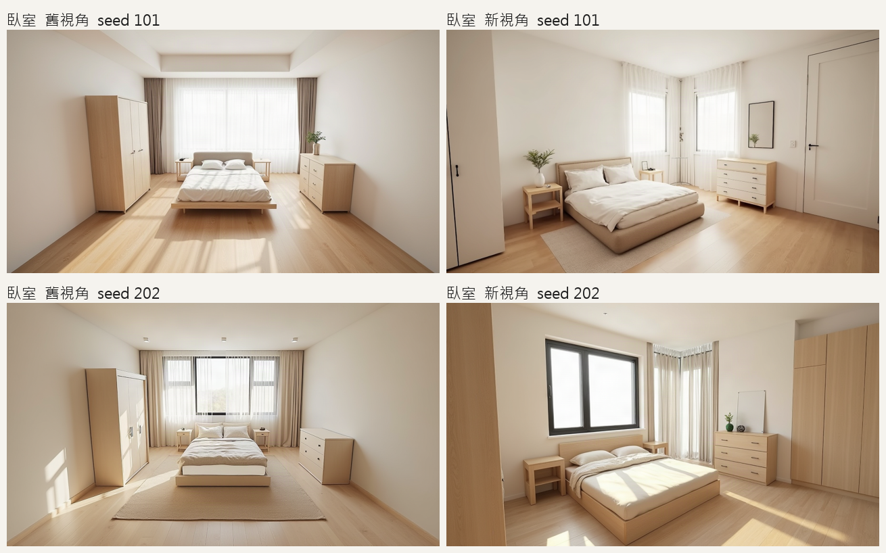

**客廳**
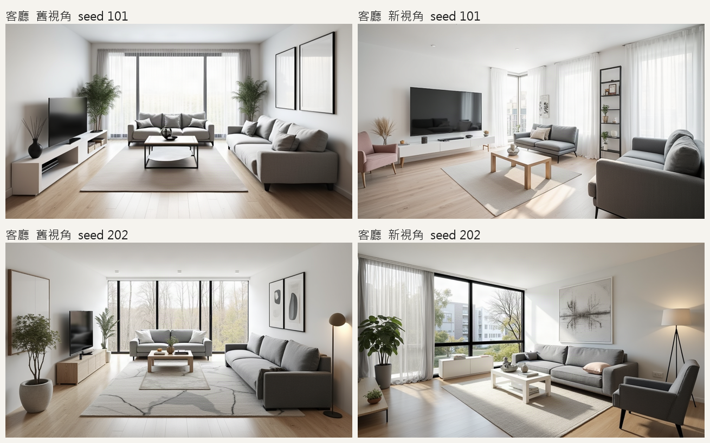

**小臥室**
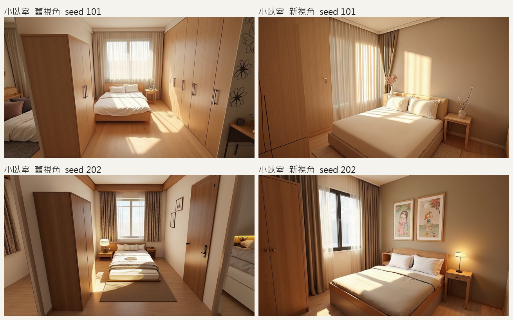

**餐廳**
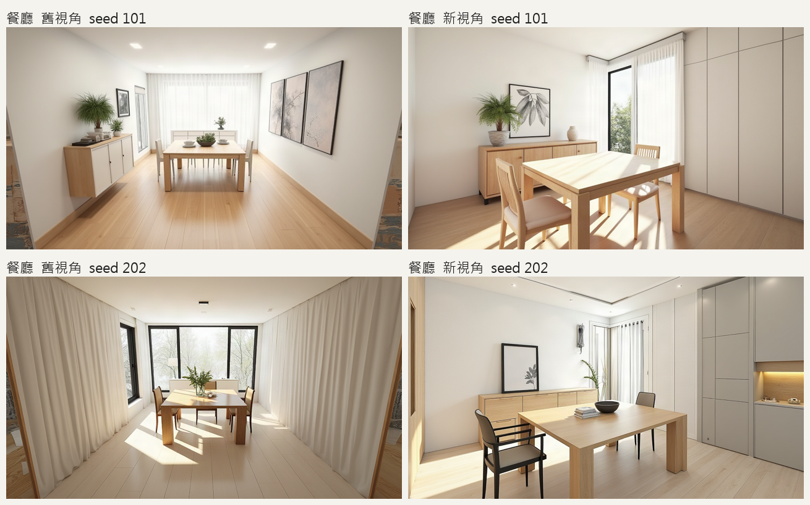

- 空間感和層次明顯比正面好，家具在畫面中比較大。
- 窄房間（小臥室、餐廳）的舊視角會看出牆外，模型就在畫面邊緣亂生東西；斜角站在房間裡，沒有這個問題。

結構圖（深度圖）：左舊版、右新版

| 場景 | 舊版 | 新版 |
|---|---|---|
| 臥室 | 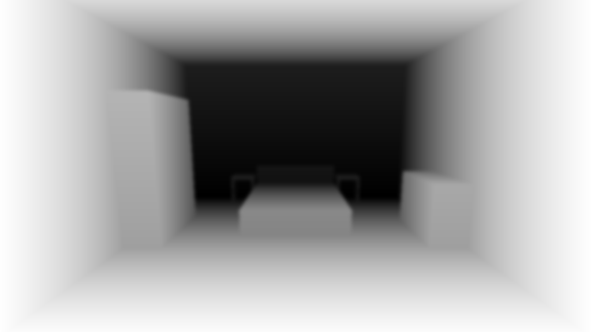 | 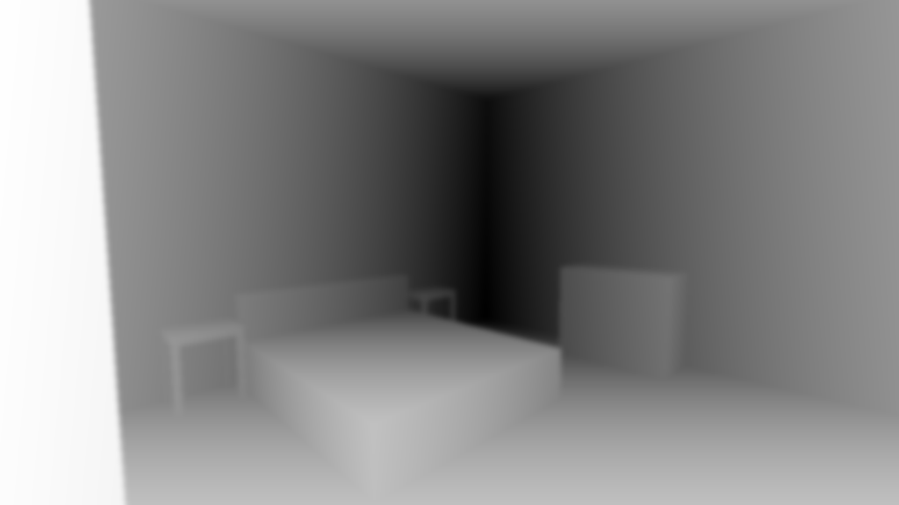 |
| 客廳 | 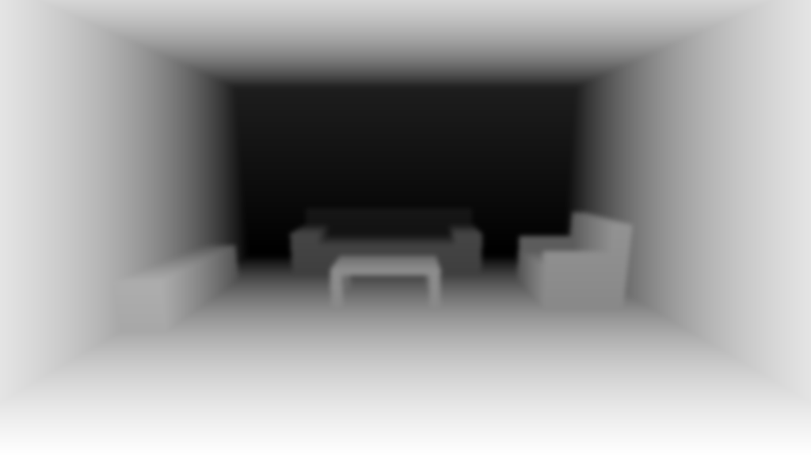 | 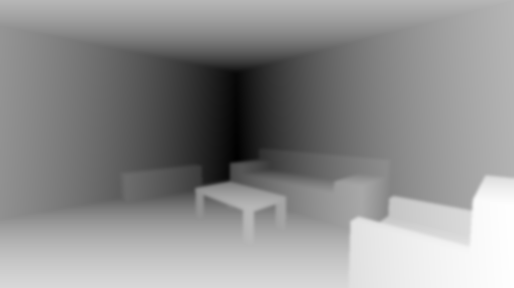 |
| 小臥室 | 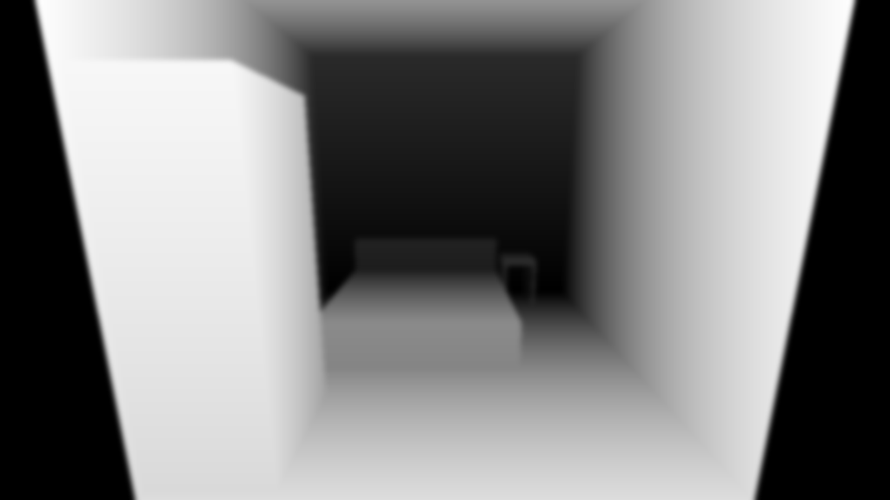 | 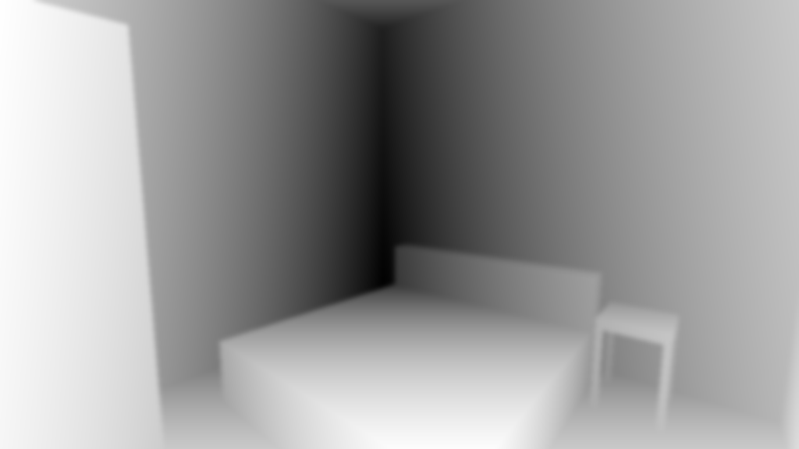 |
| 餐廳 | 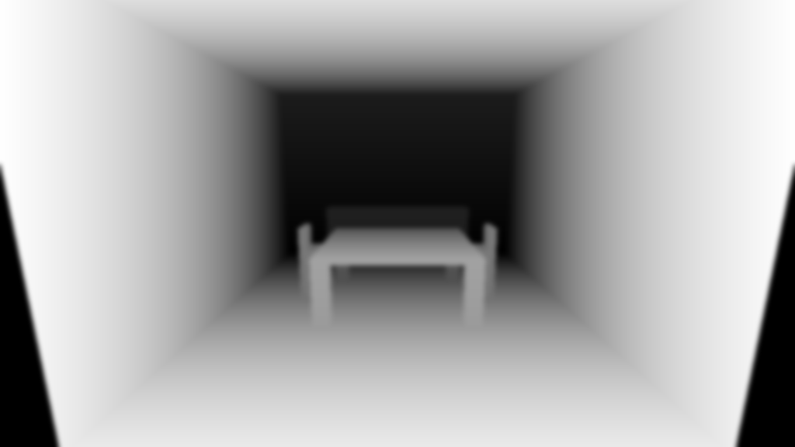 | 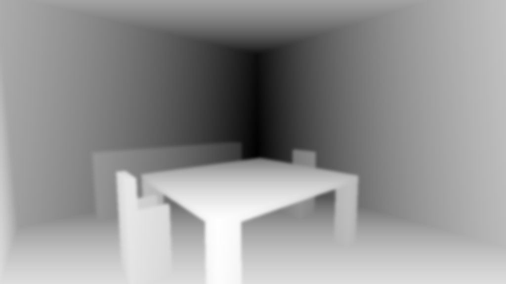 |

### 2. 但斜角會把家具切掉

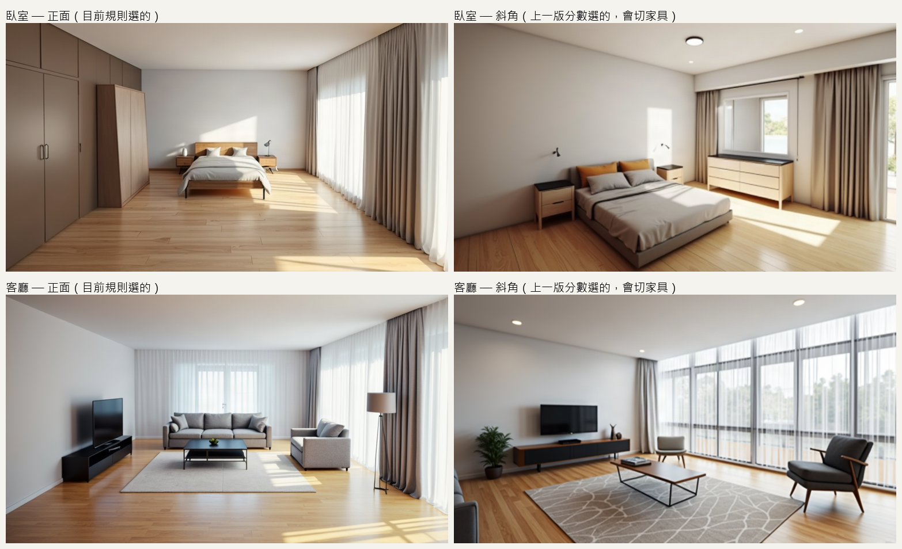

- 臥室：斜角構圖很好，但**衣櫃整個不見了**。
- 客廳：斜角空間感很好，但**沙發只剩左下角一小塊**。

單張原圖：[臥室正面](images/camera_view_test/render_bedroom_front.png)、[臥室斜角](images/camera_view_test/render_bedroom_corner.png)、[客廳正面](images/camera_view_test/render_living_front.png)、[客廳斜角](images/camera_view_test/render_living_corner.png)

### 3. 規則改完後的選擇

每件家具「最看得到的程度」最低的那一件（1.0＝完全看得到）：

| 場景 | 舊的斜角選法 | 新規則 |
|---|---|---|
| 臥室 | 0.54（有一件幾乎看不到） | 選正面，0.81 |
| 客廳 | 0.52 | 選正面，0.84 |
| 小臥室 | 0.26 | 選正面，0.85 |

5 個測試場景最後**全部選正面**。保住了家具，代價是構圖比較平。

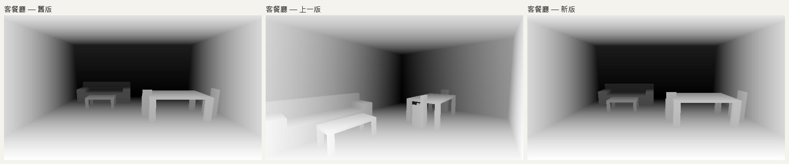

### 4. 讓所有家具裝進畫面（原型，還沒放進正式流程）

做法：調整朝向和視野，剛好裝下所有家具，裝不下就放棄這個站位。

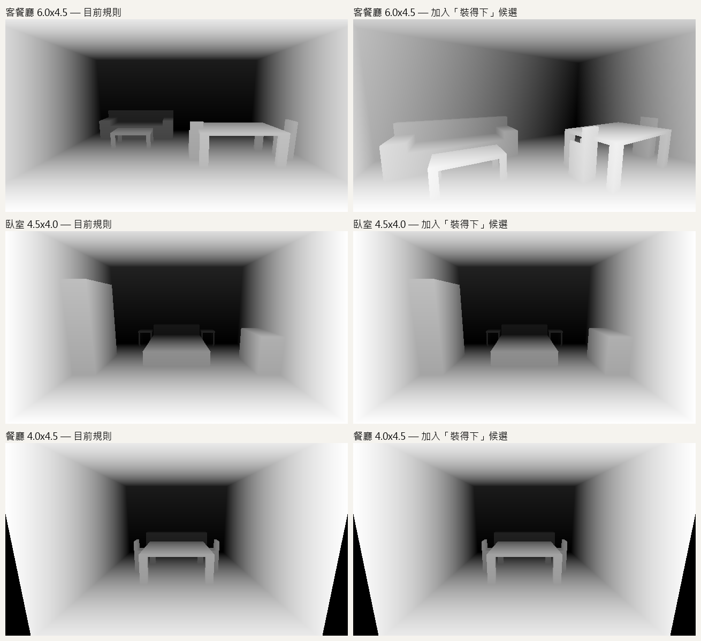

- **客餐廳**：成功。斜角構圖更好，家具都在畫面內。
- **臥室、客廳、小臥室、餐廳**：裝不下。家具貼著入口側的牆，站在角落時它們會落在相機側邊或後方，視野要超過 76° 才拍得到，畫面會變形。

客餐廳實際生圖（上列正面、下列斜角；左：結構圖，右：生成結果）：

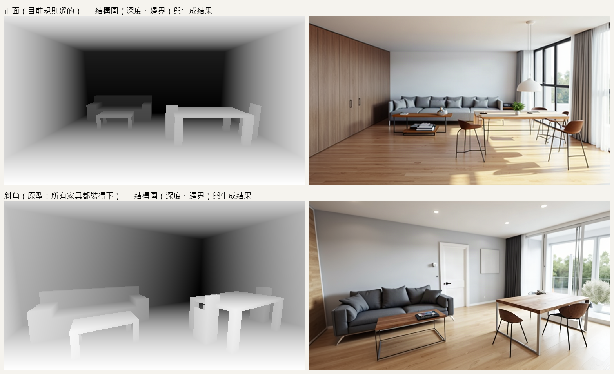

單張原圖：[正面](images/camera_view_test/dining_living_front_render.png)、[斜角](images/camera_view_test/dining_living_fit_render.png)

### 5. 後端兩條渲染路徑

一開始只改了路徑 A，使用者實際走的路徑 B 還是舊相機，所以看不到新視角。已補修，下圖是修補後路徑 B 的深度圖與邊界圖（上列舊相機、下列新相機）：

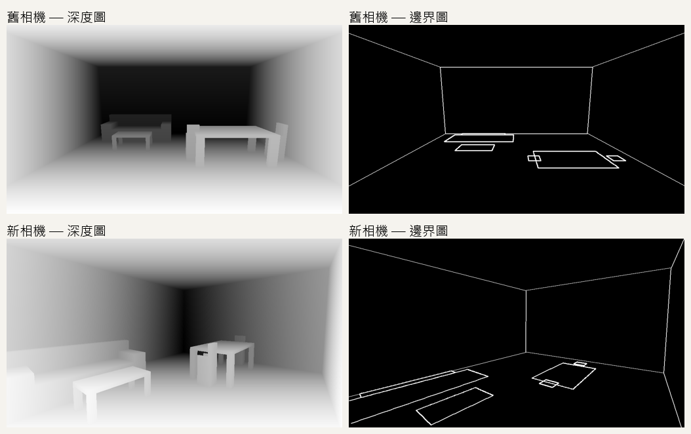

## 限制

- 樣本很小（5 個場景、每個 1–2 張），圖片是目視判斷，結論僅供參考。
- 家具配置是手寫的，不是 AI 版面生成的真實輸出。
- 3D 預覽的預設視角沒有跟著改，預覽和實際渲染的視角差異會更明顯。
- `test_golden` 測試在改動之前就是失敗的，這次改動讓它多一個差異（記錄的相機多了 `eye_xz`、`target_xz` 欄位）。
- 相關的程式碼和新增的測試**還沒有推上 repo**，這份報告只是紀錄結果。

## 待決定

1. 要不要把「讓所有家具裝進畫面」整合進正式流程？
2. 要不要放寬規則，只要求主要家具（床、沙發、桌子、衣櫃）完整，植物、床頭櫃這類小東西切掉也可以？這樣臥室類場景比較有機會出現斜角。

## 其他發現（尚未驗證）

桌腳、椅腳常壞掉，可能原因：椅子在結構圖裡是一整塊實心、沒有腳；桌腳畫成粗方柱；細長結構本來就容易生壞。建議先小規模實驗再改。
