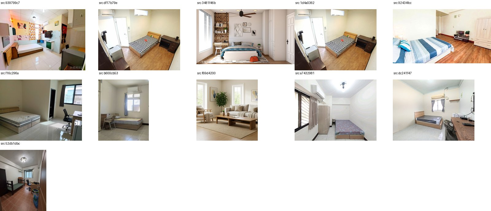
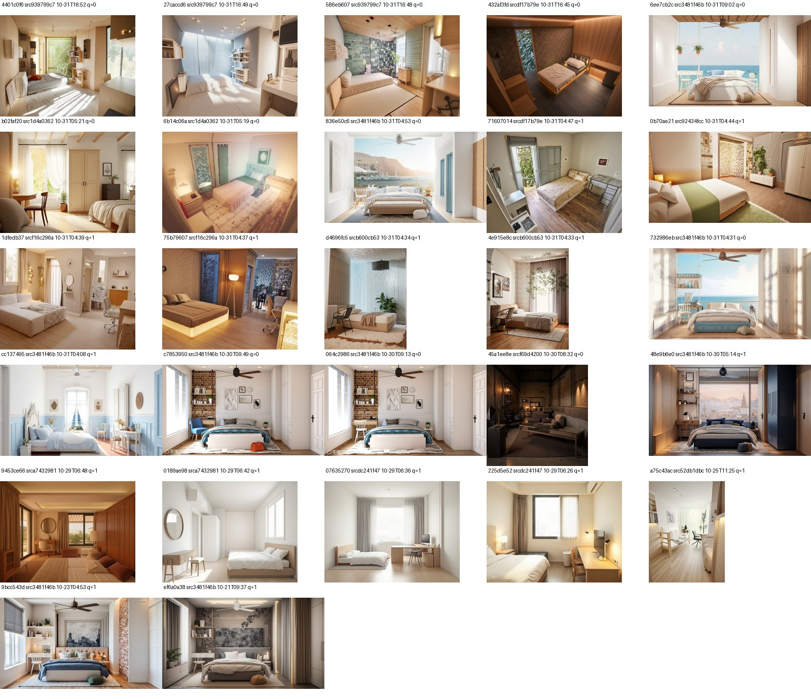

# DEMO 寫死方案

`demo` branch 專用。目標：DEMO 當天不依賴即時 AI 生成，範例流程走預先確認 OK 的結果；沒命中範例就退回真後端。

> 狀態：整層平面圖流程已大致完成；租屋處改造（照片流程）尚未實作，只做了素材盤點。**所有改動尚未 commit。**

## 1. 運作方式

- 只在 [frontend/src/config/api.js](../frontend/src/config/api.js) 的 `jsonFetch` 攔截，邏輯集中在 [frontend/src/config/demo.js](../frontend/src/config/demo.js)，各 composable 幾乎不動。
- `DEMO_MODE` 在 demo branch **預設開**（不需要環境變數）；要關掉設 `VITE_DEMO_MODE=0`（寫在專案根目錄的 `.env.local`，vite 的 `envDir` 是根目錄）。
- 命中就回傳 fixture 並假裝等一下（讓 loading 動畫跑完），沒命中走真後端。
- 範例 prompt 按鈕：[DemoPromptChips.vue](../frontend/src/components/DemoPromptChips.vue)，放在「描述你理想中的空間…」等三個輸入框；點了填入文字並**自動觸發智慧風格推薦**。

## 2. 目前已寫死（整層平面圖流程）

| 步驟 | 端點 | 觸發條件 | 等待 | Fixture |
|---|---|---|---|---|
| 上傳並辨識房間 | `/api/detect-rooms` | 按「解析平面圖」（**不論上傳哪張圖**，也不實際上傳） | 3 秒 | `demoDetectRooms.json`（11 間房、門窗、整層 SVG，50 坪） |
| 點進房間的家具辨識 | `/api/parse-floor-plan` | 房型與尺寸對得上錄好的那間 | 2 秒 | `demoParseRooms.json`（主臥、客房、廚房、餐廳、客廳、書房） |
| 生成渲染圖 | `/api/generate` | 見下 | 5 秒 | `demoGen.json` + `public/demo/gen/*.png` |

`/api/generate` 命中條件（缺一就走真後端）：

1. 剛按過「解析平面圖」（`demoPlan` 是記憶體狀態，**重新整理頁面就會消失**，要重新上傳）。
2. 走整層流程、點進某一間房（請求的 `space_id` 對得上）。
3. 描述包含四句範例 prompt 之一的**完整文字**。
4. 是新生成：`plan` 裡沒有 `generated_image_path`（換風格、局部修改不攔截）；批次套用風格只帶 `style_params`，所以會命中。

命中只看「房間 + 範例 prompt」，**跟畫面上點哪張風格卡無關**。顯示的風格是當初生成時用的那張（見下），標籤可能對不上。

### 已有圖的組合（`demoGen.json`，共 17 組）

| 房間 | 第 1 句 溫暖可愛 | 第 2 句 小坪數明亮 | 第 3 句 咖啡廳 | 第 4 句 飯店質感 |
|---|---|---|---|---|
| 客廳 | ✓ | ✓ | ✓ | ✓ |
| 餐廳 | ✓ | ✓（需重生，見下） | ✓ | ✓ |
| 主臥室 | ✓ | | | |
| 客房、廚房、書房 | ✓ | | | |
| 浴室、小廁所、玄關、陽台、工作陽台 | ✓ | | | |

DEMO 先**只用第 1 句**，所以「套用風格到其他房間」（批次）整層 11 間都有圖。其他三句只有客廳、餐廳有圖。

### 四句範例 prompt（[demoPrompts.js](../frontend/src/config/demoPrompts.js)）

1. 家裡有小孩和老人，想要可愛溫暖的感覺
2. 小坪數，想看起來寬敞明亮一點
3. 喜歡咖啡廳的悠閒氛圍
4. 想要像飯店一樣有質感、放鬆

取自首頁 StyleDeck 的四個情境。

## 3. 整層平面圖：fixture 內容與做法

- 平面圖本體：[frontend/public/demo/floorplan.png](../frontend/public/demo/floorplan.png)，並複製到 `artifacts/uploads/demo_floorplan.png`（逐間裁切、辨識還會讀它，**不要刪**）。
- 房間辨識用真 Gemini 錄一次；門窗做了兩處手動修正：
  - 客房→餐廳那扇門的絞鏈畫反：`DoorOpening` 新增 `flip` 欄位，[svg_render.py](../designbridge/roomplan/svg_render.py) 依它換絞鏈端。
  - 陽台與客廳之間漏辨識的落地窗：手動補一扇（`window_3`）。
- 整層總覽圖會畫出各房家具：`render_room_plan_svg` 新增 `furniture` 參數，用錄好的家具辨識結果取代預設符號。
- 家具辨識用的是真後端錄的，Gemini 每次結果略有差異（例如小廁所面積），fixture 以這次為準。

## 4. 生圖記錄與注意事項

- 生圖走真後端：`flux_depth_controlnet_fal`（fal 的 FLUX + 深度圖 ControlNet，深度圖由平面圖家具佈局投影），套風格 LoRA，風格圖用該句 prompt 風格搜尋的第一張。
- 客廳第 1 句：第一張風格推薦圖是深色玄關（相似度 0.49），跟「可愛溫暖」方向相反，結果只帶到抽象畫與壁燈。改用第 4 張（美式暖居）重生一張較自然，但決定**保留第一版**（`public/demo/gen/room_9_kids-warm.png`）；第二版存成 `room_9_kids-warm_v2.png` 備用。
- **餐廳第 2 句用的是 `flux_fal`**（沒有深度約束，家具位置不一定對得上平面圖），建議重生。
- fal 餘額曾用完，造成一批生成退回 `placeholder`（沒圖）。生成後務必檢查 `generation_params.backend` 不是 `placeholder`、圖檔存在。
- 電視櫃在客廳平面圖的南牆，相機從南向北看，畫面裡看不到，這是佈局與相機造成的，不是 bug。

## 5. 不建議寫死（本來就快又穩）

`/api/render-floor-plan`（本地 pycairo）、佈局編輯器拖曳、`/room-plan` CAD 工具、風格搜尋與預覽、家具瀏覽、收藏、歷史紀錄、`upload-image`、`crop-floor-plan`、`rescale-upload-plan`。

點進房間時 `crop-floor-plan` 與 `render-floor-plan` 仍走真後端，所以**後端要開著**。

## 6. 尚未寫死

| 功能 | 狀況 |
|---|---|
| 換風格（結果頁一鍵換風格） | 帶 `plan`，目前走真後端 |
| 局部修改 | 走真後端；輸出取決於塗抹位置，只能做劇本式 |
| 移動家具 | 進入模式（切割，首次約 40 秒）建議寫死；套用移動取決於拖曳位置 |
| 報價 | 資料庫已有 173 筆報價記錄可重用，尚未接上 |
| 全景圖 | 資料庫已有 18 筆全景記錄，尚未接上 |
| 風水檢查 | 未處理 |
| 其他三句 prompt 的其餘房間 | 要等 fal 餘額 |
| L 型房間外觀 | 偵測到的輪廓是真的，整層圖轉矩形時被拉直。玄關約佔外框 60%、餐廳 79%，可在總覽圖改畫輪廓，點進房間仍是矩形；尚未做 |

## 7. 租屋處改造（照片流程）：素材盤點

**現況：還沒寫死。** 租屋流程只有 [StepPhotoStudio.vue](../frontend/src/components/steps/StepPhotoStudio.vue) 一頁（四個功能：修改風格、調整家具位置、置換或刪除家具、家具估價清單）。我早先放在 [StepPhotoUpload.vue](../frontend/src/components/steps/StepPhotoUpload.vue) 的「使用範例照片」與 `demoPhoto` 攔截，**是舊步驟，租屋流程不會經過，攔截不會觸發**，之後要改。

| 功能 | 端點 | 可寫死？ |
|---|---|---|
| 上傳 + 家具偵測 | `/api/upload-image` + `/api/photo-layout` | 可，錄一次（本機模型，10–20 秒） |
| 修改風格 | `/api/generate`（`restyle: true`） | 可，素材現成 |
| 調整家具位置 | `/api/move-furniture/*`、`/api/photo-move` | 切割可錄；套用取決於拖曳 |
| 置換或刪除家具 | `/api/generate`（遮罩） | 難，只能劇本式 |
| 家具估價清單 | `/api/quotation` | 可，資料庫有現成記錄 |

### 既有素材

1. **首頁換風格圖**：[frontend/src/assets/home/](../frontend/src/assets/home/) 的 `demo-original.jpg` + 8 張 `demo-<style>.jpg`，同一張客廳照、同一視角換 8 種風格，品質穩定。
2. **Supabase `designs` 表**（210 筆）：報價 173 筆、照片流程 27 筆（其中 15 筆也有報價）、全景 18 筆。圖在私有 bucket `designs`，用後端的 service role 讀取。
3. **照片流程的 27 筆記錄**用了 **11 張真實租屋房間照片**，總覽圖：
   - 原照片：
   - 結果圖：
4. 其中原照片 `3481f46b`（磚牆、吊扇、白衣櫃的臥室）最完整，一組有：地中海風格多版本、換藍色布沙發、刪除家具、多筆報價，租屋四個功能幾乎都有現成結果。
5. 本機 `artifacts/render/d07283b5…_28a4bea2.png` 與 `…_mv7ba620.png` 是一組移動家具前後對照（大理石客廳、黃色單人椅），但不是首頁那張客廳照。

### 建議

以 `3481f46b` 那組當租屋 DEMO 主角，不用花 fal。還需要：把這組 9 筆按時間排序、確認哪張是原照片與各版本關係，並確認 Storage 圖檔都還在。

## 8. 待辦與提醒

- [ ] 自己走一遍整層流程（上傳平面圖 → 客廳 → 範例 prompt → 生成 → 批次套用風格），**目前沒有在瀏覽器實測過**。
- [ ] 決定租屋 DEMO 用哪組素材並實作。
- [ ] 報價、全景接上資料庫既有記錄。
- [ ] 移動家具進入模式寫死。
- [ ] 重生餐廳第 2 句；若要展示其他 prompt，補主臥等房間。
- [ ] 確認後 commit 到 `demo` branch（目前所有改動皆未 commit，包含 `public/demo/`、`demoGen.json` 約 14 MB 圖片）。
- repo 已搬到 `https://github.com/yukiyang08/designbridge.git`，舊 remote 靠轉址仍可 push。
