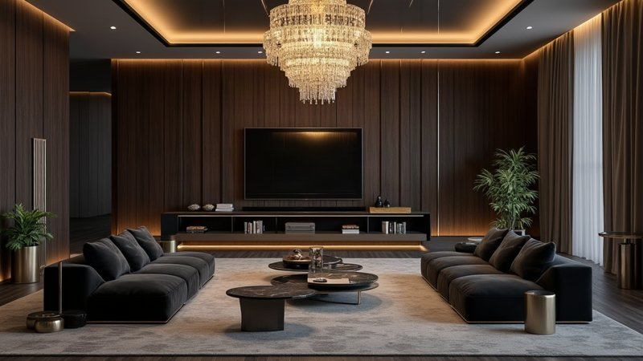
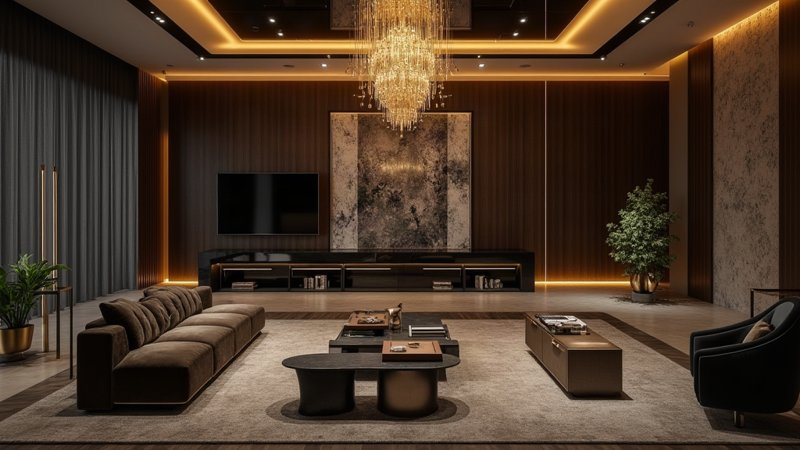
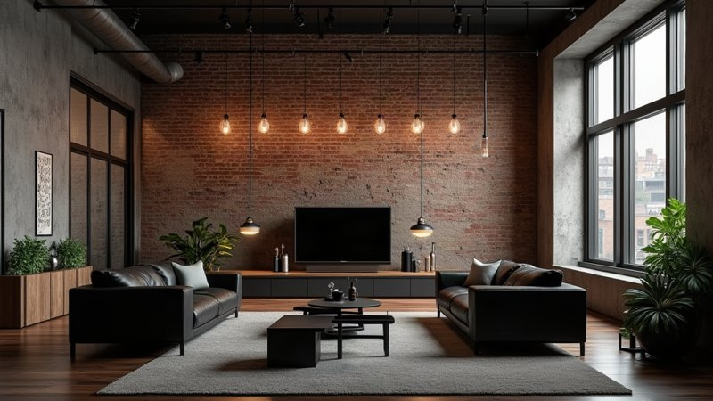
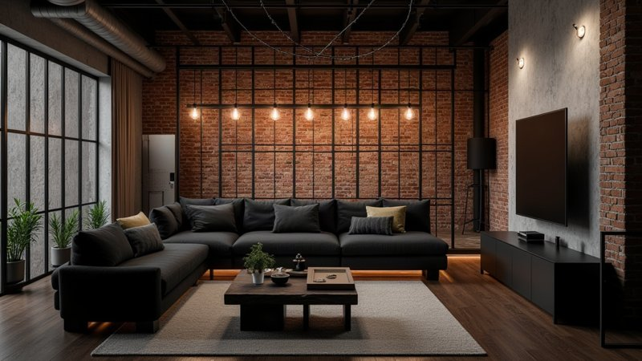
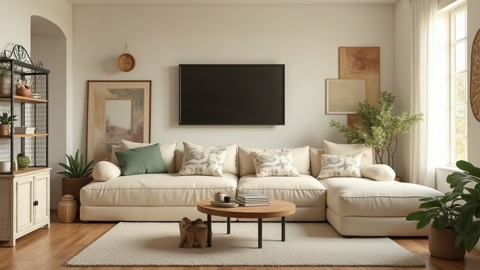
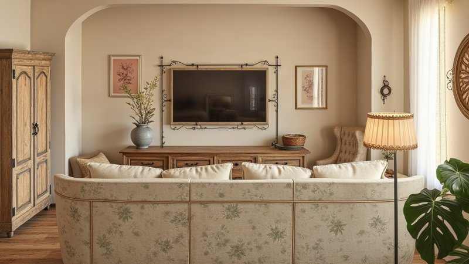
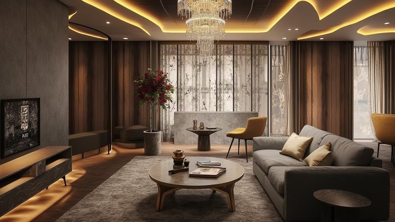
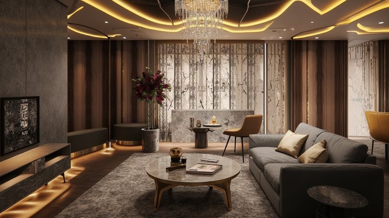
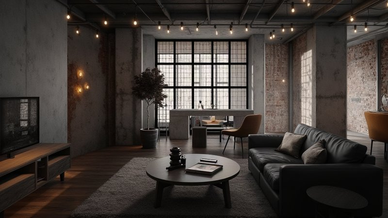
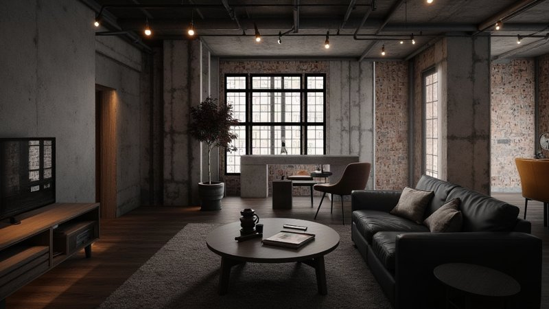

# 風格 LoRA 有無對比

資料來源：[style_swap_ab/report.md](style_swap_ab/report.md)（2026-10-11 實測）。同一張基準圖、同一個 plan、同一個 seed（42）、同樣的 ControlNet 深度條件，**唯一差別是有沒有掛該風格的 LoRA**。

## 並排圖

基準 A = 文字＋家具位置（投影深度）；基準 B = 真實照片（照片深度）。

| 組 | 風格 | 無 LoRA | 有 LoRA |
|---|---|---|---|
| A | 奢華 |  |  |
| A | 工業 |  |  |
| A | 鄉村 |  |  |
| B | 奢華 |  |  |
| B | 工業 |  |  |

## 數字（5 組平均，來自 report.md 5.2、4）

| 指標 | 無 LoRA | 有 LoRA |
|---|---|---|
| 像素變化（越高＝改變越多） | 0.41 | 0.42 |
| 結構相關（越高＝越貼近基準構圖） | 0.81 | 0.84 |
| 總耗時 | 14.1s | 17.8s（多約 3.7s） |

## 判讀（主觀，每條件只跑 1 次）

- **基準 B（真實照片）：兩者幾乎一樣。** 奢華、工業兩組結構相關都是 0.88–0.89，畫面只在細節上有差，LoRA 看不出決定性優勢。
- **基準 A（投影深度）：有差異但不一致。**
  - 工業：有 LoRA 的磚牆更完整、工業感更集中；無 LoRA 時電視跑到正中央。
  - 鄉村：有 LoRA 的裝飾元素（花紋沙發、木櫃、落地燈）更多，構圖也更近景；無 LoRA 較乾淨、偏簡約。
  - 奢華：兩者都有水晶燈與暗調氛圍，差異不大。
- 代價是每次多約 3.7 秒。

## 限制

- 樣本只有 5 組、客廳 1 種房型、每條件 1 次，沒有重複與盲測，是傾向不是統計結論。
- 數字只是粗略代理，建議後續找 3–5 人盲測評分。
- 另有 [images/img2img_lora_ab/](images/img2img_lora_ab/)（img2img 有無 LoRA）可對照，本檔未收錄。
