# img2img 參數掃描：負向 prompt／步數／guidance

測試時間：2026-10-11 12:33:53　seed：42（img2img 組這次有真正送給 fal）　strength：0.85

## 1. 測試設定

- 基準圖：文字＋家具位置的現代風客廳（投影深度），重新生成了一張，因此**不能與 report.md 的圖直接比較**。
- 風格：工業風、奢華風。每種風格各 6 個條件，img2img 組都使用同一張基準圖、同一個 plan、同一個 seed 42。
- 步數預設 20 → 調成 28；guidance 預設 3.5 → 調成 5.5；負向 prompt 見下。
- 「ControlNet 參考」只是當作風格強度的目標對照（正式做法、不含 LoRA）。
- 結構相關／像素變化是輔助指標，定義同 report.md。
- 注意：基準 A 的 composer 會用 LLM 合成 prompt，各次措辭略有不同（風格關鍵詞相同）。

- 負向 prompt（工業風）：`white walls, bright daylight, light beige fabric sofa, airy pastel room, bright white curtains`
- 負向 prompt（奢華風）：`plain white walls, casual minimalist decor, light beige fabric sofa, bare plain ceiling, rustic wood`

## 2. 基準圖

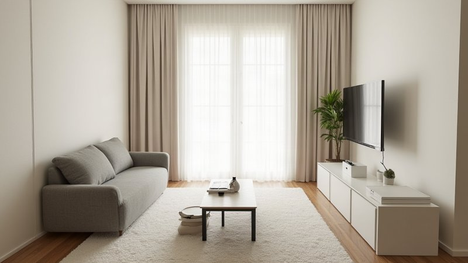　耗時 568.9s、backend flux_controlnet_depth_fal

## 3. 結果

### 工業風

| 項目 | ControlNet 參考（無 LoRA） | img2img 0.85（原設定） | ＋負向 prompt | 步數 28 | guidance 5.5 | 三者合用 |
|---|---|---|---|---|---|---|
| 圖片 | 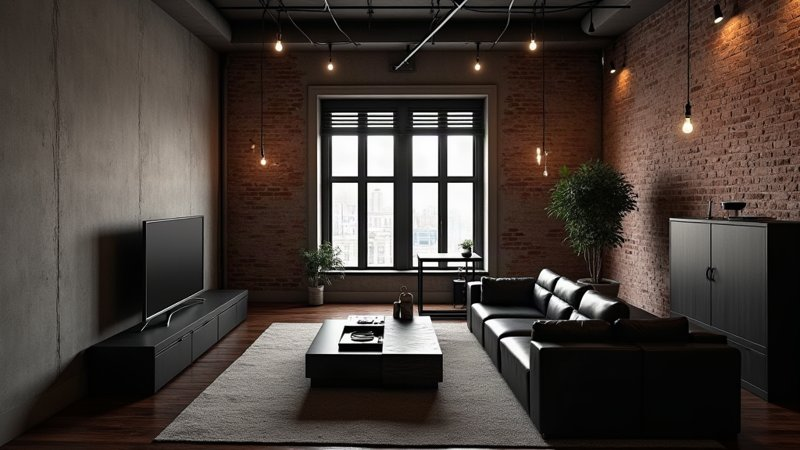 | 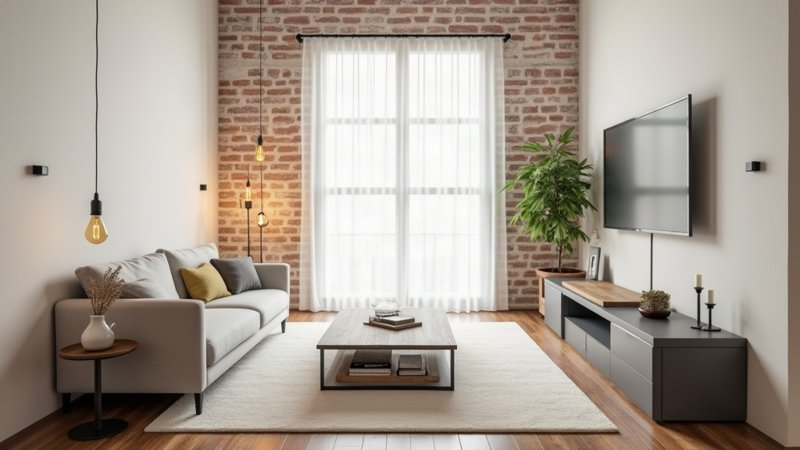 | 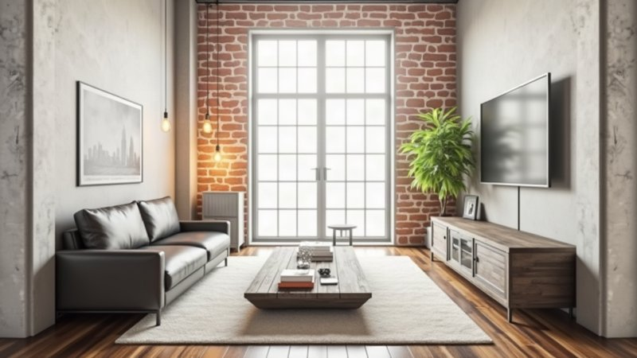 | 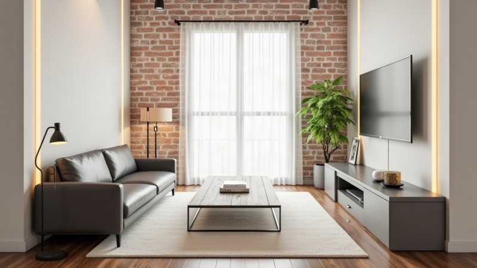 | 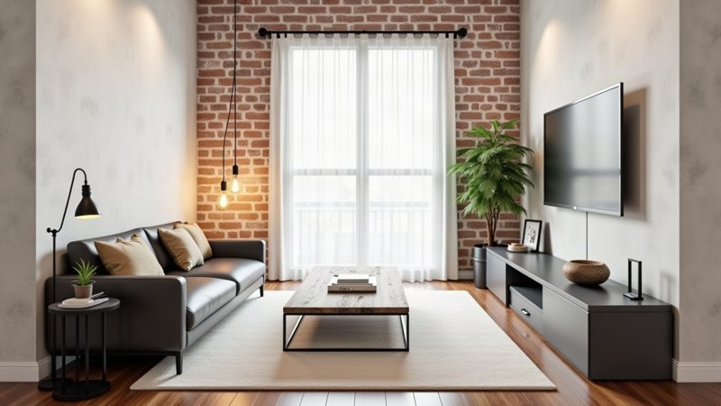 | 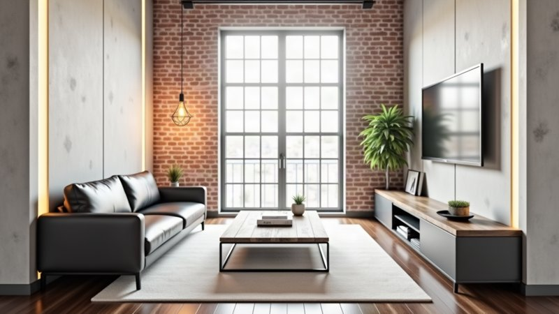 |
| backend | flux_controlnet_depth_fal | flux_img2img_fal | flux_img2img_fal | flux_img2img_fal | flux_img2img_fal | flux_img2img_fal |
| 總耗時 | 20.0s | 17.2s | 21.1s | 17.1s | 16.1s | 17.4s |
| 生圖呼叫 | 15.2s | 12.6s | 15.7s | 12.2s | 11.5s | 13.4s |
| 結構相關（↑越像基準） | 0.89 | 0.99 | 0.98 | 0.98 | 0.98 | 0.98 |
| 像素變化（↑改變多） | 0.41 | 0.11 | 0.13 | 0.12 | 0.14 | 0.15 |
| 步數 / guidance | — | 20 / 3.5 | 20 / 3.5 | 28 / 3.5 | 20 / 5.5 | 28 / 5.5 |

### 奢華風

| 項目 | ControlNet 參考（無 LoRA） | img2img 0.85（原設定） | ＋負向 prompt | 步數 28 | guidance 5.5 | 三者合用 |
|---|---|---|---|---|---|---|
| 圖片 | 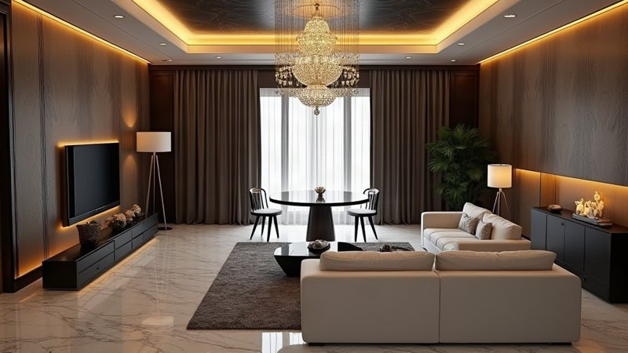 | 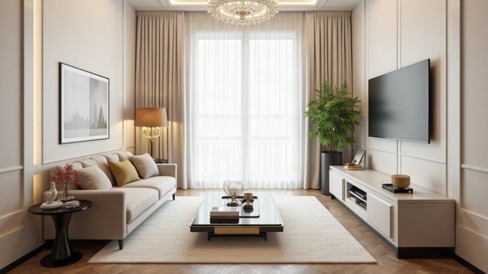 | 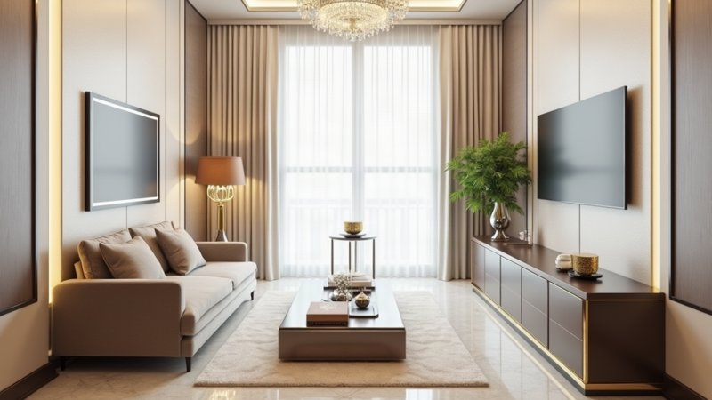 | 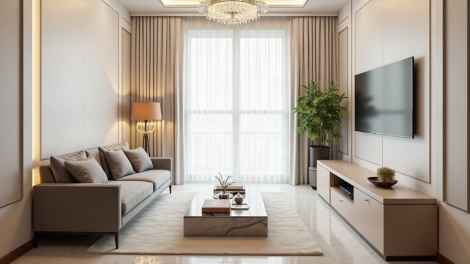 | 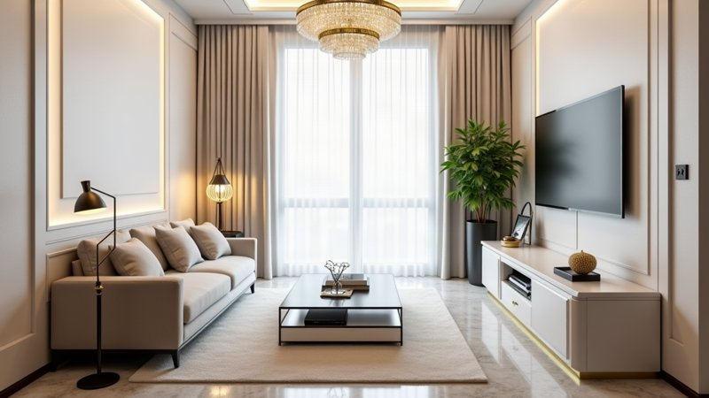 | 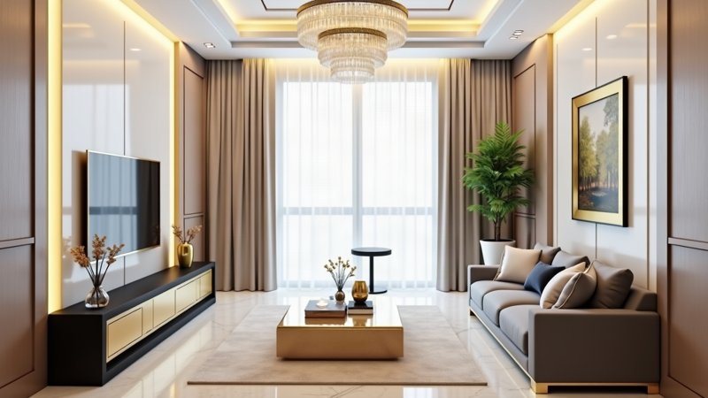 |
| backend | flux_controlnet_depth_fal | flux_img2img_fal | flux_img2img_fal | flux_img2img_fal | flux_img2img_fal | flux_img2img_fal |
| 總耗時 | 17.7s | 15.0s | 16.7s | 17.9s | 14.4s | 18.8s |
| 生圖呼叫 | 13.5s | 10.5s | 12.4s | 13.8s | 10.5s | 14.5s |
| 結構相關（↑越像基準） | 0.73 | 0.97 | 0.97 | 0.97 | 0.96 | 0.88 |
| 像素變化（↑改變多） | 0.34 | 0.10 | 0.12 | 0.11 | 0.11 | 0.15 |
| 步數 / guidance | — | 20 / 3.5 | 20 / 3.5 | 28 / 3.5 | 20 / 5.5 | 28 / 5.5 |

## 4. 觀察與結論

> 圖片判讀是我（Claude）看縮圖後的主觀描述，請對照第 3 節的圖自行確認。每個條件只跑 1 次、同一個 seed，**無法區分「參數的效果」與「單次隨機波動」**，以下是傾向，不是定論。

### 4.1 參數有把「物件層級」的風格推上去，但「整體氛圍」沒變

| 風格 | 原設定 | 調參後的變化 |
|---|---|---|
| 工業風 | 灰色布沙發、白牆、明亮 | **沙發變黑皮**（＋負向、步數 28、guidance 5.5 三個單獨條件都出現）、牆面多了水泥板與發光燈條；房間仍然明亮、地毯與牆面仍偏白 |
| 奢華風 | 米色沙發、水晶吊燈、大理石地板 | 電視櫃變深色木飾加金邊、牆面出現深木飾板；整體仍偏明亮米色 |

- 結構相關在 img2img 各組都很高（0.96–0.99），像素變化只有 0.10–0.15：**畫面和基準圖幾乎同一個房間**，調參只讓像素變化從 0.10–0.11 增加到 0.11–0.15。
- ControlNet 參考（像素變化 0.34–0.41）明顯更暗、更戲劇化，是想要的「完整風格」；但它的**構圖與基準圖不同**（工業風的電視與沙發左右對調、視角不同，結構相關 0.73–0.89）。
- 結論：調參數能改善**個別物件**（沙發顏色、牆面材質），但**整體明暗與色調**仍被基準圖主導，與前面的推論一致（起始圖的低頻資訊殘留）。

### 4.2 各參數

- **負向 prompt**：工業風的沙發變黑皮，方向正確；但步數 28 與 guidance 5.5 單獨也出現黑沙發，所以這張圖不能證明是負向 prompt 的功勞。奢華風的差異較不明顯。
- **步數 28、guidance 5.5**：單獨使用的效果都很小。
- **三者合用**：工業風的結構仍保持（0.98），奢華風風格最強（深木飾板、金色點綴），**但結構被破壞**（結構相關降到 0.88，電視與沙發左右對調）。也就是風格與結構的取捨在此出現。

### 4.3 耗時

- img2img 14–21 秒，ControlNet 參考 18–20 秒。
- 步數 20→28 沒有明顯變慢（工業 17.2→17.1 秒、奢華 15.0→17.9 秒），guidance 也不影響耗時。**這暗示固定開銷（排隊、上傳、下載）占比不小**，所以前面提過的「降低步數來加速」可能效果有限（需要更多樣本確認）。
- 基準圖耗時 569 秒是第一次呼叫的冷啟動，不代表常態。

### 4.4 結論與下一步

1. 光調這三個參數**不足以**讓 img2img 達到 ControlNet 的風格強度，主要原因是整體色調被基準圖繼承。
2. 若仍想用 img2img，值得再試：**先把基準圖調暗／降彩度再丟進去**（針對暗調風格）、strength 0.9–0.95，或 img2img 加深度 ControlNet。
3. 若目標是風格明顯，維持 ControlNet 較合理（見 report.md）。
4. 本次樣本：單一房型、單一 seed、每條件 1 次。

### 4.5 這次為了測試動到的程式（預設行為不變）

- [routers/common.py](../../routers/common.py)：`DesignRequest` 新增 `img2img_steps_override`、`img2img_guidance_override`、`img2img_negative_prompt_override`。
- [render_backends.py](../../designbridge/render/render_backends.py)：`_render_flux_img2img_fal` 新增 `negative_prompt`、`seed` 參數，有給才送給 fal。
- [renderer.py](../../designbridge/core/nodes/renderer.py)：img2img 現在會把 seed 傳給 fal（先前沒有傳，初版 report.md 的 img2img 組因此是隨機 seed）；上述三個覆寫有給才生效。
- 這條 img2img 路徑只有 debug 覆寫才會觸發，不影響正式的換風格流程。

