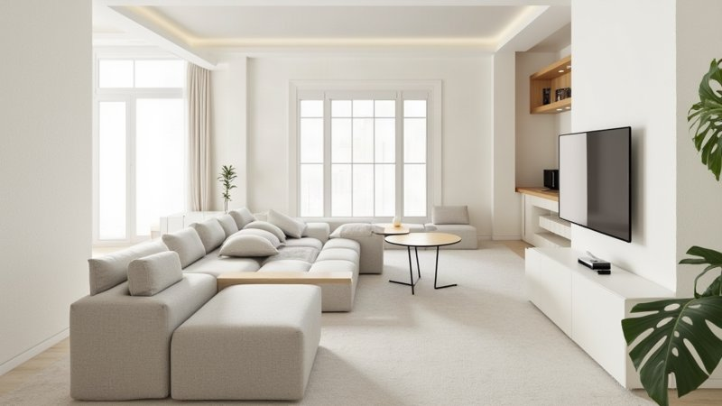
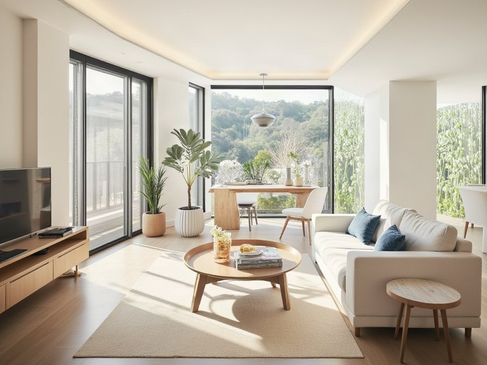
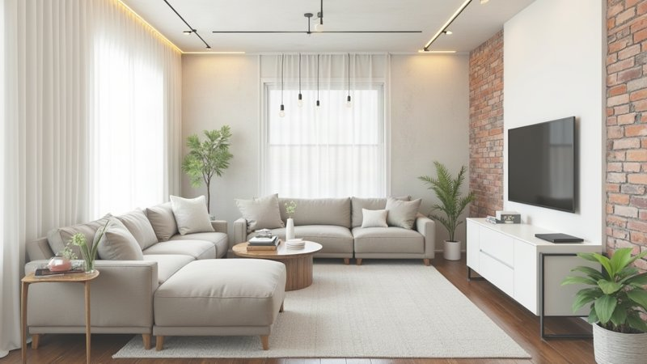
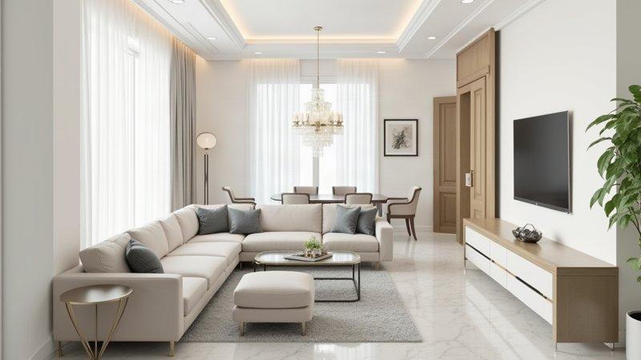
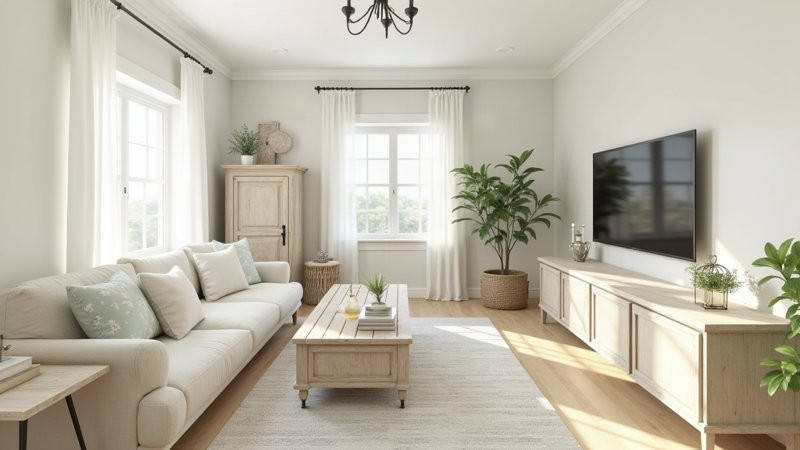
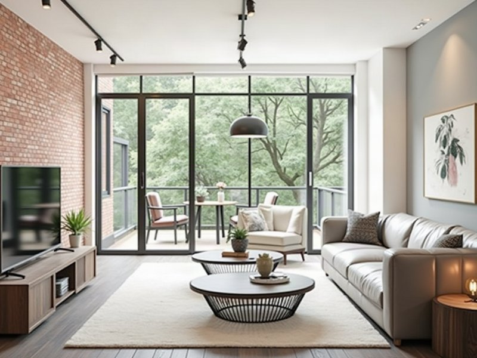
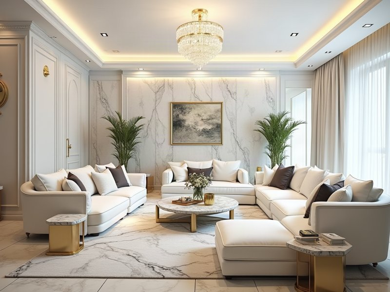

# 換風格 A/B 實測：ControlNet vs img2img

⚠️ 更正：初版寫「同一個 seed」對 img2img 組不成立，見第 1 節。

測試時間：2026-10-11 11:56:37　seed：42　img2img 強度：0.85

> 後續：img2img 參數（負向 prompt／步數／guidance）掃描見 [params_report.md](params_report.md)。

## 1. 測試設定

- 每組在**同一張基準圖、同一個 plan**下，只換「生圖方法」。ControlNet 兩組使用相同 seed；**img2img 組的 seed 沒有送給 fal**（`_render_flux_img2img_fal` 目前沒有 seed 參數），所以是隨機的，這是這份測試未控制到的變因。prompt 在基準 B 的 2 組兩種方法完全相同；基準 A 的 3 組因為 composer 會用 LLM 把家具位置與風格詞合成一段文字，每次呼叫的措辭略有不同（風格關鍵詞相同，見第 5 節附錄）。
- ControlNet：fal `flux-general` + Depth ControlNet + Canny 邊緣；強度由程式上限決定（投影深度 0.3、照片深度 ≤0.65）。
- img2img：fal `flux-general/image-to-image`，以基準圖為起始圖，prompt 只靠 `_STYLE_LOOK` 描述。
- 「ControlNet（正式）」含該風格的 LoRA，是目前上線的做法；「無 LoRA」與 img2img 的條件一致，是公平比較的主組。
- 結構相關 / 像素變化是輔助指標：前者越高代表與基準圖的空間結構越接近，後者越高代表畫面改變越多。不能取代肉眼判斷。
- 耗時來自後端 `[timing]` 紀錄；「總耗時」是整段 `/api/generate`，渲染節點內含生圖呼叫與補跑深度。

## 2. 基準圖

| 基準 | 說明 | 圖 | backend | 總耗時 |
|---|---|---|---|---|
| A | 文字＋家具位置（投影深度）（現代風） |  | flux_controlnet_depth_fal | 286.9s |
| B | 真實照片（照片深度）（現代風） |  | flux_controlnet_depth_fal | 33.7s |

## 3. 五組結果

### 組 1：基準 A（文字＋家具位置（投影深度））→ 工業風

| 項目 | 基準圖 | ControlNet（正式，含風格 LoRA） | ControlNet（無 LoRA） | img2img 0.85（無 LoRA） |
|---|---|---|---|---|
| 圖片 |  |  |  |  |
| backend |  | flux_controlnet_depth_fal | flux_controlnet_depth_fal | flux_img2img_fal |
| 總耗時 |  | 19.6s | 15.1s | 12.6s |
| 渲染節點 |  | 16.7s | 12.3s | 9.7s |
| 　└ 生圖呼叫 |  | 16.6s | 12.2s | 9.6s |
| 　└ 補跑深度 |  | — | — | — |
| 風格/合成節點 |  | 2.7s | 2.5s | 2.7s |
| CLIP 評分 |  | 0.2s | 0.2s | 0.2s |
| 結構相關（↑越像） |  | 0.89 | 0.80 | 0.92 |
| 像素變化（↑改變多） |  | 0.50 | 0.47 | 0.11 |
| 參數 |  | 深度強度 0.3 | 深度強度 0.3 | strength 0.85 |
| LoRA |  | designbridge_v5_flux1dev_industrial.safetensors | 無 | 無 |

### 組 2：基準 A（文字＋家具位置（投影深度））→ 奢華風

| 項目 | 基準圖 | ControlNet（正式，含風格 LoRA） | ControlNet（無 LoRA） | img2img 0.85（無 LoRA） |
|---|---|---|---|---|
| 圖片 |  |  |  |  |
| backend |  | flux_controlnet_depth_fal | flux_controlnet_depth_fal | flux_img2img_fal |
| 總耗時 |  | 21.1s | 13.5s | 13.9s |
| 渲染節點 |  | 16.6s | 11.0s | 8.8s |
| 　└ 生圖呼叫 |  | 16.5s | 10.9s | 8.8s |
| 　└ 補跑深度 |  | — | — | — |
| 風格/合成節點 |  | 4.3s | 2.2s | 4.9s |
| CLIP 評分 |  | 0.2s | 0.3s | 0.2s |
| 結構相關（↑越像） |  | 0.74 | 0.68 | 0.86 |
| 像素變化（↑改變多） |  | 0.50 | 0.50 | 0.11 |
| 參數 |  | 深度強度 0.3 | 深度強度 0.3 | strength 0.85 |
| LoRA |  | designbridge_v5_flux1dev_luxury.safetensors | 無 | 無 |

### 組 3：基準 A（文字＋家具位置（投影深度））→ 鄉村風

| 項目 | 基準圖 | ControlNet（正式，含風格 LoRA） | ControlNet（無 LoRA） | img2img 0.85（無 LoRA） |
|---|---|---|---|---|
| 圖片 |  |  |  |  |
| backend |  | flux_controlnet_depth_fal | flux_controlnet_depth_fal | flux_img2img_fal |
| 總耗時 |  | 17.7s | 14.6s | 12.1s |
| 渲染節點 |  | 15.0s | 12.1s | 9.4s |
| 　└ 生圖呼叫 |  | 14.9s | 12.0s | 9.3s |
| 　└ 補跑深度 |  | — | — | — |
| 風格/合成節點 |  | 2.5s | 2.3s | 2.5s |
| CLIP 評分 |  | 0.2s | 0.2s | 0.2s |
| 結構相關（↑越像） |  | 0.78 | 0.79 | 0.87 |
| 像素變化（↑改變多） |  | 0.23 | 0.23 | 0.14 |
| 參數 |  | 深度強度 0.3 | 深度強度 0.3 | strength 0.85 |
| LoRA |  | designbridge_v5_flux1dev_country.safetensors | 無 | 無 |

### 組 4：基準 B（真實照片（照片深度））→ 工業風

| 項目 | 基準圖 | ControlNet（正式，含風格 LoRA） | ControlNet（無 LoRA） | img2img 0.85（無 LoRA） |
|---|---|---|---|---|
| 圖片 |  |  |  |  |
| backend |  | flux_controlnet_depth_fal | flux_controlnet_depth_fal | flux_img2img_fal |
| 總耗時 |  | 15.7s | 13.0s | 11.2s |
| 渲染節點 |  | 15.1s | 12.5s | 10.6s |
| 　└ 生圖呼叫 |  | 14.8s | 12.2s | 10.3s |
| 　└ 補跑深度 |  | — | — | — |
| 風格/合成節點 |  | 0.3s | 0.4s | 0.3s |
| CLIP 評分 |  | 0.2s | 0.1s | 0.2s |
| 結構相關（↑越像） |  | 0.89 | 0.89 | 0.87 |
| 像素變化（↑改變多） |  | 0.47 | 0.46 | 0.16 |
| 參數 |  | 深度強度 0.65 | 深度強度 0.65 | strength 0.85 |
| LoRA |  | designbridge_v5_flux1dev_industrial.safetensors | 無 | 無 |

### 組 5：基準 B（真實照片（照片深度））→ 奢華風

| 項目 | 基準圖 | ControlNet（正式，含風格 LoRA） | ControlNet（無 LoRA） | img2img 0.85（無 LoRA） |
|---|---|---|---|---|
| 圖片 |  |  |  |  |
| backend |  | flux_controlnet_depth_fal | flux_controlnet_depth_fal | flux_img2img_fal |
| 總耗時 |  | 14.8s | 14.3s | 11.7s |
| 渲染節點 |  | 14.2s | 13.8s | 11.1s |
| 　└ 生圖呼叫 |  | 14.0s | 13.5s | 10.8s |
| 　└ 補跑深度 |  | — | — | — |
| 風格/合成節點 |  | 0.3s | 0.3s | 0.4s |
| CLIP 評分 |  | 0.2s | 0.2s | 0.2s |
| 結構相關（↑越像） |  | 0.88 | 0.89 | 0.88 |
| 像素變化（↑改變多） |  | 0.39 | 0.38 | 0.15 |
| 參數 |  | 深度強度 0.65 | 深度強度 0.65 | strength 0.85 |
| LoRA |  | designbridge_v5_flux1dev_luxury.safetensors | 無 | 無 |

## 4. 各階段耗時彙總（5 組平均）

| 階段 | ControlNet（正式，含風格 LoRA） | ControlNet（無 LoRA） | img2img 0.85（無 LoRA） |
|---|---|---|---|
| 總耗時 | 17.8s | 14.1s | 12.3s |
| requirement_analyzer | 0.0s | 0.0s | 0.0s |
| visual_preprocessing | 0.0s | 0.0s | 0.0s |
| layout_and_style_agent | 0.7s | 0.5s | 0.5s |
| composer | 1.3s | 1.1s | 1.7s |
| renderer | 15.5s | 12.3s | 9.9s |
| clip_evaluator | 0.2s | 0.2s | 0.2s |
| 　└ renderer.flux_controlnet_depth_fal | 15.4s | 12.2s | — |
| 　└ renderer.flux_img2img_fal | — | — | 9.8s |

## 5. 觀察與結論

> 以下圖片判讀是我（Claude）逐組看過縮圖後的主觀描述，建議你自己再對照第 3 節的圖確認。每種條件只跑 1 次、seed 固定，沒有重複，所以耗時有隨機波動，結論是「這批樣本的傾向」，不是統計結論。

### 5.1 速度：瓶頸在 fal 的生圖呼叫，不在本機

- 生圖呼叫（`renderer.flux_*`）占總耗時約 80%：ControlNet 12–15 秒、img2img 約 10 秒。本機其餘節點加起來約 2–3 秒（風格搜尋 0.4–0.6s、composer 1–2s、CLIP 0.2s）。
- 換風格時沒有觸發「補跑深度估計」，需求分析與視覺預處理也因為帶了 plan 而被跳過（0.0s）。
- img2img 平均 12.3s，比 ControlNet 無 LoRA（14.1s）快約 13%，比正式做法（含 LoRA，17.8s）快約 31%。**沒有任何一種方法接近 3–5 秒**。
- 風格 LoRA 平均多花約 3.7 秒（17.8s vs 14.1s）。
- 基準圖 A 的 250 秒（renderer）與 21 秒（style_search）是第一次呼叫的冷啟動與模型載入，不代表一般狀況；基準圖 B 為 33.7 秒（其中視覺預處理 8 秒、生圖 15.7 秒）。

### 5.2 風格強度與結構保持（輔助指標平均：像素變化 / 結構相關 / 耗時）

| 範圍 | ControlNet（正式，含 LoRA） | ControlNet（無 LoRA） | img2img 0.85（無 LoRA） |
|---|---|---|---|
| 全部 5 組 | 0.42 / 0.84 / 17.8s | 0.41 / 0.81 / 14.1s | 0.13 / 0.88 / 12.3s |
| 基準 A（文字＋投影深度，3 組） | 0.41 / 0.80 / 19.5s | 0.40 / 0.76 / 14.4s | 0.12 / 0.89 / 12.9s |
| 基準 B（真實照片，2 組） | 0.43 / 0.89 / 15.2s | 0.42 / 0.89 / 13.7s | 0.15 / 0.87 / 11.4s |

- **風格強度：ControlNet 明顯強於 img2img 0.85。** 5 組都是如此：工業風 ControlNet 出現深色磚牆、黑皮沙發、暗調燈光，img2img 仍是明亮白色空間，只多了一面磚牆和軌道燈；奢華風 ControlNet 是深木飾板、水晶燈、暗調氛圍，img2img 是白色大理石加金色點綴的明亮版本。像素變化也反映這點（ControlNet 0.23–0.50，img2img 0.11–0.16）。
- **結構保持：看基準類型。**
  - 基準 A（投影深度，ControlNet 強度被限制在 0.3）：img2img 的結構相關較高（平均 0.89，ControlNet 為 0.76–0.80），畫面上也保留了 L 型沙發與右牆電視。ControlNet 的構圖變動較大（鄉村風被拉近成特寫、工業風無 LoRA 時電視跑到正中央）。
  - 基準 B（真實照片深度，強度 0.65）：兩者結構相關差不多（0.87–0.89），ControlNet 的電視在左、沙發在右、圓茶几居中的配置與基準圖一致；img2img 在奢華風那組沙發配置改變較多，視角也變了。
- **鄉村風是 img2img 表現最可接受的一組**（淺色系風格與基準圖的明亮色調相近）；工業風、奢華風這類需要大幅轉成暗調的風格，img2img 0.85 不夠。

### 5.3 結論（暫定，需更多樣本驗證）

1. **有真實照片時：用 ControlNet。** 風格強、結構保持得住，速度差距不大。
2. **只有文字／版面（投影深度）時：要看你重視什麼。**
   - 要「同一個房間換風格」的感覺、風格偏淺色（鄉村、北歐、日式）：img2img 可用，約快 2–5 秒。
   - 要風格轉變夠明顯（工業、奢華、古典）：ControlNet，代價是構圖可能變動。
3. **風格 LoRA 這批測試中看不出決定性優勢**：多花約 3.7 秒，畫面風格有些差異但不一致（工業風有 LoRA 時整面磚牆更完整，奢華風兩者相近）。
4. **想要更快，換方法的幫助有限**，因為時間在 fal 的生圖。要大幅縮短得靠預先生成、降低步數或解析度（見前面討論）。

### 5.4 限制與下一步

- 只測 img2img 強度 0.85；0.9 可能讓工業風、奢華風更明顯，但結構會更不穩。
- 每條件只跑 1 次，沒量變異。
- 基準圖只有客廳 1 種房型。
- 輔助指標（深度相關、像素差）只是粗略代理，不能取代人工評分。建議之後找 3–5 人盲測。


## 附錄：實際送出的 prompt（第 1 組）

**ControlNet（正式，含風格 LoRA）**

```
A photorealistic industrial loft living room featuring exposed concrete and red brick walls, black steel frames, and polished dark wood flooring. In the front center sits a dark fabric upholstered sofa, complemented by a low reclaimed dark wood coffee table placed on the left back. Against the back center wall is a sleek media console with a wall-mounted flat TV, balanced by a potted green plant in the right back corner. A small side table rests against the right middle wall, and a dark storage cabinet sits against the front left corner. Edison bulb pendant lights, track lighting, and integrated warm LED strips cast moody, high-contrast dim illumination, accentuating gray, charcoal, and warm tan textures.
```

**ControlNet（無 LoRA）**

```
Photorealistic industrial loft living room with raw exposed concrete walls, weathered red brick, polished dark wood flooring, and black steel frames. In the center front, a low-profile dark leather sofa sits opposite a wall-mounted flat TV above a dark wood media console against the back wall. To the left back, a low coffee table; to the left front, a rustic storage cabinet. A sleek side table rests against the right wall, with a vibrant potted green plant nestled in the back-right corner. High-contrast moody dim lighting with warm Edison bulb pendants, black track lights, and subtle LED strips highlights raw textures, charcoal tones, and warm tan accents in a sophisticated aesthetic.
```

**img2img 0.85（無 LoRA）**

```
Photorealistic industrial loft living room with exposed concrete and red brick walls, polished dark wood flooring, and moody dim ambient lighting paired with warm LED strips and Edison bulb pendants. Centered in the foreground sits a dark leather sofa. On the left side towards the back, a low reclaimed dark wood coffee table rests, while a storage cabinet anchors the front left corner. Against the center back wall, a flat TV is mounted above a black steel frame media console. A sleek side table sits along the middle right wall, and a vibrant potted green plant brightens the back right corner. Sophisticated charcoal, raw gray, and warm tan palette with high-contrast lighting.
```
