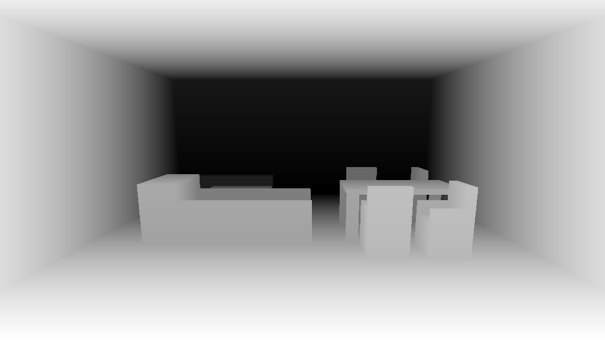
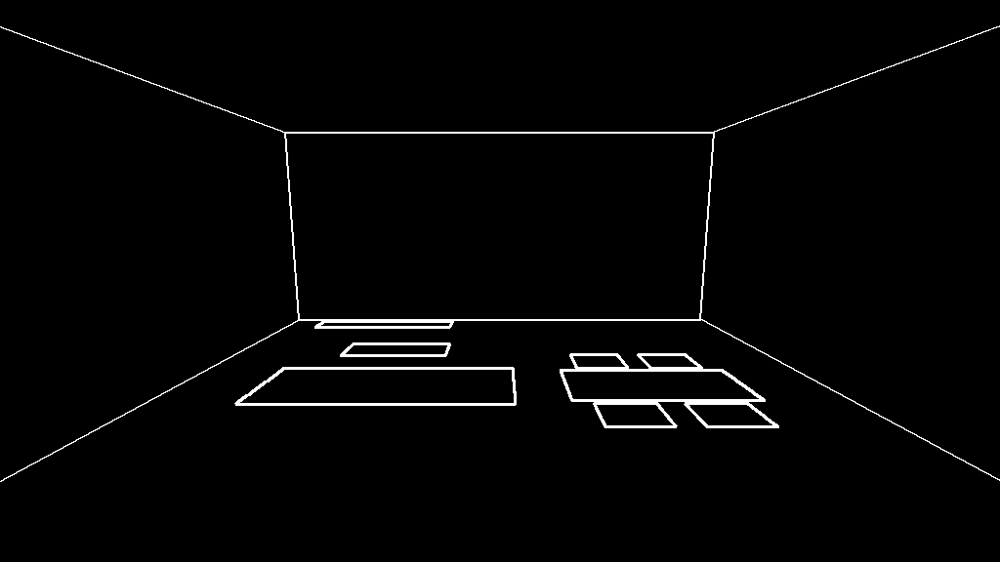
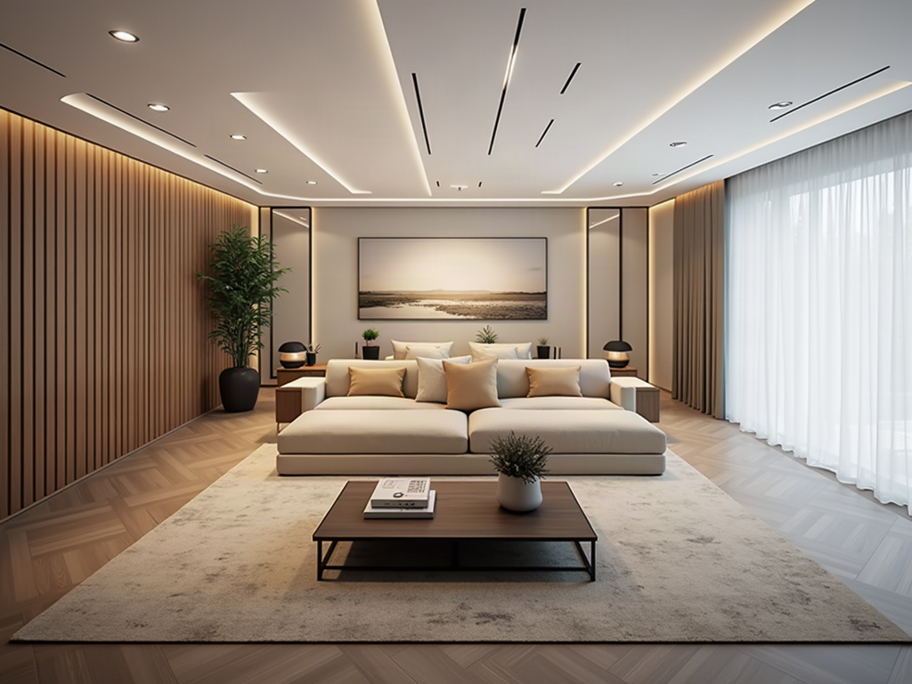
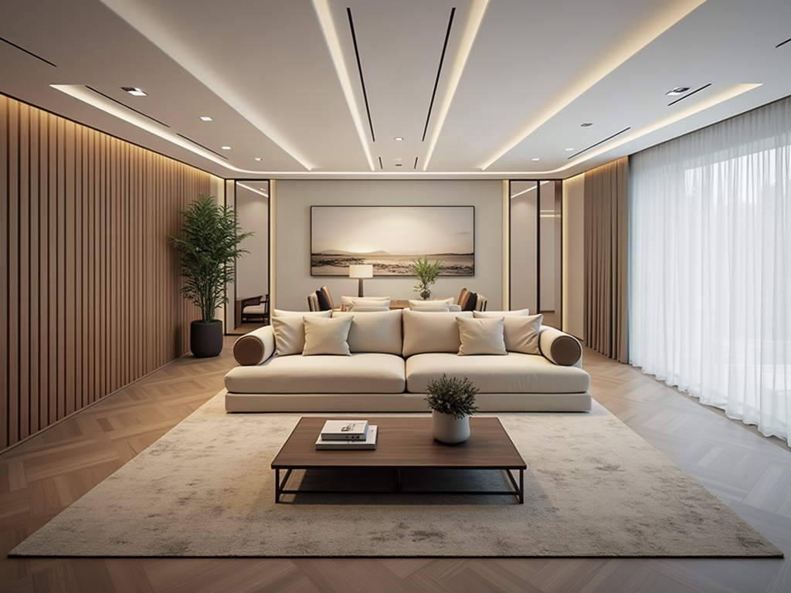
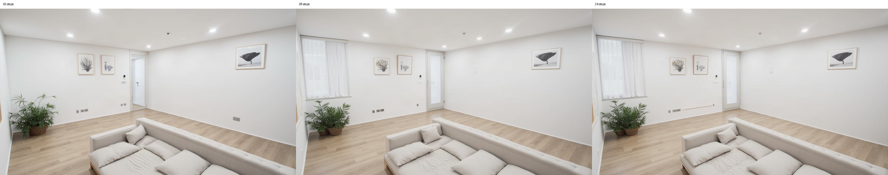
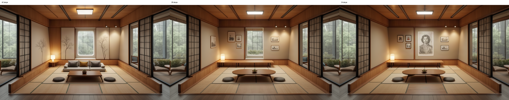
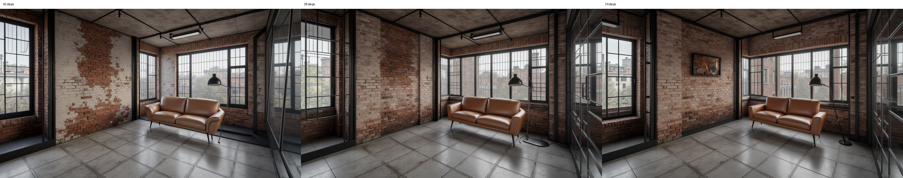

# ControlNet 生圖速度分析

模型：`fal-ai/flux-general` + `FLUX.1-dev-ControlNet-Union-Pro`（depth + canny）。
資料來源：
- 單次 fal 呼叫實測（本文件，1024×768、seed=1）。
- 完整流程實測：[timing_report.md](experiments/style_swap_ab/timing_report.md)（2026-10-11，每情境 5 次，後端直接呼叫）。

## 1. 流程拆解

一次「首次生成」（S1，文字＋家具位置）的中位數約 **30 秒**：

| # | 階段 | 秒數（平均） | 性質 | 說明 |
|---|---|---|---|---|
| 1 | 需求分析 `requirement_analyzer` | 8.0 | LLM | 決定新設計或局部修改 |
| 2 | 風格搜尋 `style_search` | 3.3 | 向量搜尋 | Supabase + bge-m3 |
| 3 | 版面規劃 `layout_agent` | 6.1 | LLM 5.4 + 最佳化 0.2 | 產出家具位置，投影成 depth / edge 圖 |
| 4 | composer | 1.9 | 本機 | 僅版面路徑 |
| 5 | renderer：上傳條件圖 | ≈3 | 網路 | 兩張約 4 KB 的 PNG，串行上傳 |
| 6 | renderer：fal 排隊 | 0.7–4.7 | fal | 暖機時 |
| 7 | renderer：fal 推論 | 7–11 | GPU | 24–42 步，暖機後 |
| 8 | renderer：下載結果 | ≈3 | 網路 | 含寫檔 |
| 9 | clip_evaluator | 0.7 | 本機 | 不影響圖片，可後置 |

5–8 合計即報表中的「生圖呼叫」，中位數 15.7 秒。

換風格（S3 版面基準 / S4 照片基準）只剩 5–8 與少量本機工作，中位數 **19.8 / 15.4 秒**，其中 fal 生圖呼叫佔 14–16 秒，本機其餘僅 2–4 秒。

| 情境 | 總耗時中位數 | 生圖呼叫中位數 | 其餘中位數 |
|---|---|---|---|
| S1 文字＋家具位置 首次 | 29.5 | 15.7 | 13.9 |
| S2 照片 首次 | 24.3 | 15.7 | 8.7 |
| S3 換風格（版面） | 19.8 | 16.1 | 4.2 |
| S4 換風格（照片） | 15.4 | 13.7 | 1.8 |

## 2. 單次 fal 呼叫實測

### 輸入條件圖

| depth | edges |
|---|---|
|  |  |

### 耗時

| 次序 | 方式 | 步數 | fal 總時間 | 排隊 | fal 推論 | 整體（wall） | wall − fal 總時間 |
|---|---|---|---|---|---|---|---|
| 1 | 上傳 | 42 | 56.7s | 0.9s | 55.3s | 62.5s | 5.9s |
| 2 | 上傳 | 24 | 8.2s | 0.7s | 7.0s | 15.3s | 7.1s |
| 3 | 上傳 | 42 | 15.9s | 4.7s | 10.8s | 23.3s | 7.4s |
| 4 | data URI | 24 | 118.7s | 56.9s | 59.9s | 121.9s | **3.2s** |
| 5 | data URI | 24 | 204.5s | 106.6s | 95.7s | 207.6s | **3.1s** |

- 第 4、5 次碰上 fal 嚴重排隊與變慢（疑似 fal 端負載），不能用來比較推論時間。但「wall − fal 總時間」不受影響，仍可比較客戶端開銷。
- 兩張條件圖串行上傳實測約 2.3–3.9 秒，併行約 1.0–1.3 秒（3 輪）。
- data URI 輸出與上傳版本的平均絕對像素差 0.72（0–255），尺寸相同，可視為等價（非逐位元相同，因 GPU 推論本身有細微不確定性）。

### 輸出

| 42 步（暖機） | 24 步 | 24 步（data URI） |
|---|---|---|
|  |  |  |

42 步冷啟動版：

### 上傳 / 下載優化嘗試（已實作上傳，下載無解）

| 做法 | 結果 | 採用 |
|---|---|---|
| 條件圖改 data URI | wall − fal 總時間 7 → 約 3 秒 | 是（已改 [render_backends.py](../designbridge/render/render_backends.py) 的 ControlNet-Union 函式） |
| `sync_image_mode`（結果以 data URI 回傳，免下載） | 開銷反而 3 → 4.4–5.3 秒 | 否 |
| `output_format: jpeg`（體積 1 MB → 570 KB） | 下載 3.1 → 2.6 秒，只省約 0.5 秒且多一次有損壓縮 | 否 |
| 換 Session / 關 proxy / 強制 IPv4 | 下載仍 2.1–2.8 秒，無差異 | 否 |

- 下載 1 MB 約 2–3 秒，curl 預設也是 2.5 秒，判斷是到 fal CDN 的網路吞吐限制，程式端無法明顯改善。
- 若要省這段，只能不在後端下載：讓前端直接顯示 fal 的結果網址（會失去本機備份與後續處理，需另外設計）。

## 3. 觀察

1. **fal 推論本身暖機後只要 7–11 秒**，是穩定的。主要的不確定來自 fal 的冷啟動與排隊：完整流程實測有一次 130 秒（fal 108 秒），本次單呼叫也出現 55 秒、119 秒、204 秒。**使用者最痛的是這些偶發的長尾，不是平均值。**
2. **首次生成比換風格多出的 10–14 秒都是 LLM 與搜尋**（需求分析 8.0、版面 LLM 5.4、風格搜尋 3.3）。
3. **客戶端固定開銷約 6–7 秒**（上傳約 3、下載約 3），與步數無關。
4. 換風格時本機只剩 2–4 秒，沒有可砍空間，只能動 fal 這段。

## 4. 值得做的改善

預估省時為推估值，標「實測」者有量過。

| 優先 | 改善 | 預估省時 | 影響範圍 | 風險 / 備註 |
|---|---|---|---|---|
| 1 | **條件圖改 data URI**（跳過 `fal_client.upload`） | 約 4 秒（實測：開銷 7 → 3 秒） | 所有 ControlNet 生成 | 低。圖僅 4 KB；必須維持 PNG，勿轉 JPEG。改動在 [render_backends.py:457](../designbridge/render/render_backends.py#L457) 附近 |
| 2 | **降步數** `DESIGNBRIDGE_FAL_DEPTH_STEPS` 42 → 28 | 約 2.5 秒（實測，3 情境平均推論 8.2 → 5.7） | 所有 ControlNet 生成 | 中。只改 `.env`；畫質無明顯退步，但細節與少數家具會變動，見 4.1 |
| 3 | **fal 冷啟動 / 排隊的防護**：啟動或進入 `/studio` 時送小請求暖機；對 `fal_subscribe` 設逾時並重試 | 避免 50–200 秒的長尾 | 閒置後第一次生成 | 中。暖機會花錢（小請求約零頭）；暖機有效時間未驗證，要實測 |
| 4 | **LLM 階段平行化**：風格搜尋（3.3s）與版面 LLM（5.4s）目前在 [layout_and_style.py](../designbridge/core/nodes/layout_and_style.py) 內串行 | 約 3 秒 | 僅首次生成 | 需確認兩者無資料相依；改動中等 |
| 5 | **需求分析換更快的 LLM 或縮 prompt** | 約 2–4 秒（推估） | 僅首次生成 | 中。可能影響路由判斷準確度，需用既有測試回歸 |
| 6 | **CLIP 評分後置**：先回傳圖片，評分在背景完成 | 約 0.7 秒 | 所有生成 | 低，但收益小 |
| 7 | **先出低步數預覽、背景補高品質**（感知速度） | 感知上大幅縮短 | 前端 + 後端 | 高。要改流程與前端，費用增加 |

不建議：
- **併行上傳**：已被 1 取代（data URI 不用上傳）。
- **換 turbo/schnell**：可能把推論降到 2–4 秒，但 ControlNet 貼合度與風格 LoRA 相容性未知，風險最高，除非 1–3 做完仍不夠。

組合估計（暖機情況下）：換風格約 15 → 7–9 秒；首次生成約 30 → 20–22 秒。尚未實作，數字僅為加總推估。

## 4.1 降步數實測（3 情境 × 42 / 28 / 24 步）

條件：同一函式（ControlNet-Union，depth + canny）、1024×576、seed=7、其餘參數用現行預設，無風格 LoRA。三個情境用不同版面與風格。原始資料：[results.json](images/steps_compare/results.json)。

### 耗時（fal 推論，秒）

| 情境 | 42 步 | 28 步 | 24 步 |
|---|---|---|---|
| A 北歐 | 8.14 | 5.74 | 4.95 |
| B 日式 | 8.42 | 5.74 | 5.09 |
| C 工業 | 8.17 | 5.74 | 4.97 |
| **平均** | **8.24** | **5.74** | **5.00** |
| 相對 42 步省下 | — | 約 2.5 秒（30%） | 約 3.2 秒（39%） |

推論時間跟步數近似線性，且三個情境非常一致。排隊時間（0.4–10.6 秒，A 的 24 步碰到 10.6 秒）是 fal 的波動，與步數無關，所以只比推論時間。

### 畫面比較（左 42 步、中 28 步、右 24 步）

**A 北歐**

**B 日式**

**C 工業**

### 觀察（目視，非量化）

- **三組在 28 與 24 步都沒有出現明顯畫質劣化**：沒有雜訊、模糊或結構崩壞，材質、光線、整體風格與 42 步同等水準。28 與 24 步彼此非常接近。
- **但「內容」會跟著步數變，不只是細節：**
  - A：42 步左牆沒有窗戶；28、24 步多出一扇有窗簾的窗與一道門。沙發位置一致。
  - B：**42 步有沙發、牆上樹枝裝飾與圓窗；28、24 步沙發消失，變成靠牆長凳與相框，24 步中央還出現一張人像畫。** 這是三組中差異最大的，家具清單與條件圖預期的不一致。
  - C：42 步左牆有一大片白漆剝落的怪異磚牆；28、24 步磚牆較均勻。沙發與立燈位置一致，24 步多一幅掛畫。
- 所以降步數的風險不是「變醜」，而是**同 seed 下畫面細節與少部分家具可能變動**。B 的沙發消失需要留意：ControlNet 條件強度偏低（depth 0.30、edge 0.35）時，模型本來就可能不照條件圖畫，步數不同會改變這個結果，不一定是降步數造成的退化。
- 哪一個步數「比較好」無法從 3 組判斷，42 步也有瑕疵（C 的白漆磚牆）。

### 結論

- 28 步是較保守的選擇：省約 2.5 秒，畫質在 3 組中沒有退步。24 步只多省 0.7 秒，B 組還多出突兀的人像畫。
- 家具是否照版面出現是產品重點，建議改 28 步後，用實際版面（含家具清單）對照檢查「條件圖中的家具有沒有出現」，必要時再測提高 conditioning scale。
- 樣本只有 3 個版面、1 個 seed、沒有 LoRA，結論不是統計上的保證。

## 5. 自架 AMD 雲端 GPU 的評估

做法：在 AMD Instinct（例如 MI300X）雲端主機上，用 ROCm 版 PyTorch + diffusers 載入 Hugging Face 的 `FLUX.1-dev` 與 ControlNet-Union，以自己的 API 取代 `fal-ai/flux-general`。

**可能的好處**
- 去掉 fal 的排隊與冷啟動不確定性（常駐模型）。
- 條件圖不用上傳（同機或內網傳輸）。
- 可自行調整：fp8 / `torch.compile`、固定 LoRA 預載。
- MI300X 的 192 GB VRAM 能同時放 FLUX、ControlNet、LoRA，不用換出。

**不確定或不利**
- **純推論速度不會明顯更快**：fal 暖機後本來就是 7–11 秒。我沒有 MI300X 上跑 FLUX + ControlNet-Union 的實測，不能保證能追平 NVIDIA H100 的速度；ROCm 對 diffusers 的支援與最佳化程度通常稍落後 CUDA，需要實測。
- **要自己維運**：ROCm 環境、模型載入、LoRA 熱切換、佇列、監控、當機重啟。
- **成本**：常駐 GPU 閒置也計費；若改 serverless，載入 FLUX（約 24 GB 權重）的冷啟動可能比 fal 更久。
- **授權**：`FLUX.1-dev` 為非商用授權，且是 gated 模型（需 `HF_TOKEN` 與同意條款）。商用要另外處理，與是否自架無關。
- 現有程式碼只有 fal 與本機 SDXL 兩種後端，需新增一個後端並處理 LoRA、ControlNet-Union 多控制（canny + depth）的參數對應。

**結論**
- 若主要痛點是 fal 的長尾（冷啟動、排隊），自架常駐 GPU 能解決，但代價是固定成本與維運。
- 若只是想讓平均變快，先做第 4 節的 1–3 項，成本幾乎是零，預期效果更大。
- 建議順序：先做 1–3 → 重新量長尾發生頻率 → 若仍不可接受，再用小預算租 MI300X 一小時實測 FLUX + ControlNet-Union 的暖機速度，再決定是否投入。

## 6. 限制

- 單次 fal 實測樣本很少（5 次），且 fal 負載隨時間變動，不同時段結果可能不同。
- 完整流程報表是 2026-10-11 的資料，之後程式碼有改動（例如相機視角、整戶平面圖切割）可能影響本機階段。
- 第 4 節的省時估計除標「實測」者外，均未實作驗證。
