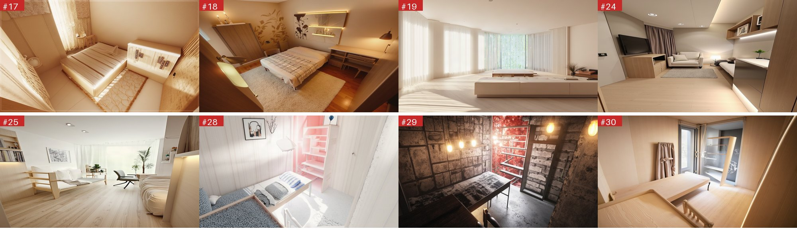
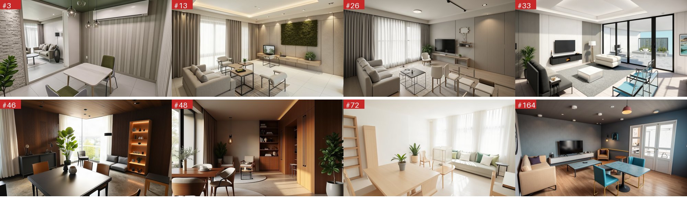
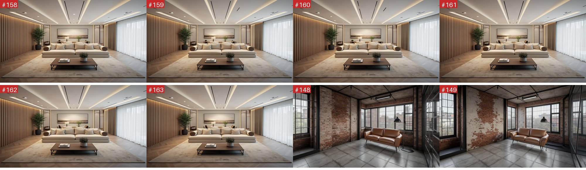
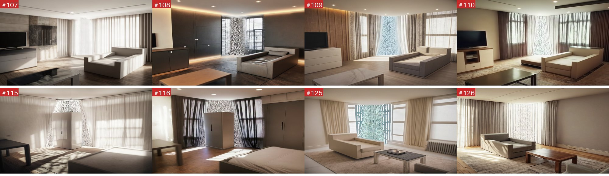
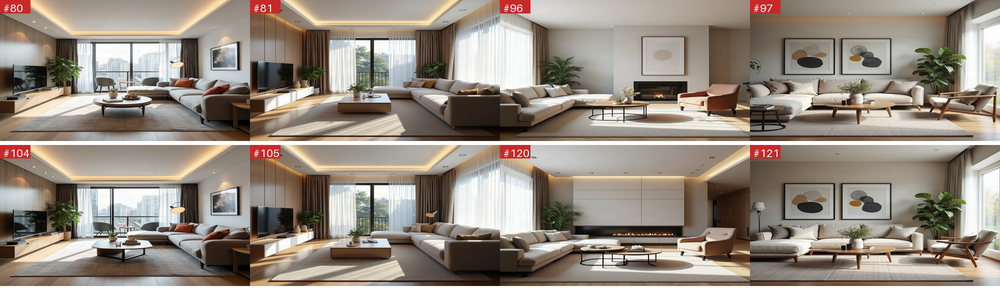
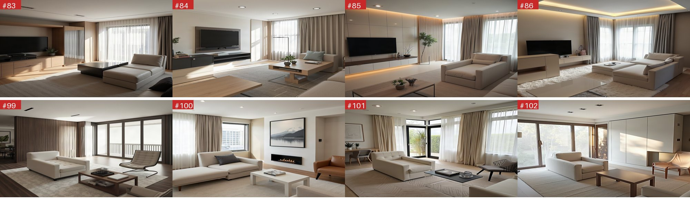

# fal 生圖歷史分析（只算現行權重）

日期：2026-10-30

> **更正（同日）**：第一版把 10/21 的權重實驗與舊設定的圖也算進來，結論被舊資料帶偏。這一版**只看現行權重**產生的圖，舊實驗移到附錄。

> **路徑對照（同日補充）**：使用者確認**平面圖／CAD 路徑**是現行主流程，其他兩條不確定是否還在用。對應關係：
> - **平面圖／CAD 路徑 = 文字流程的 Union 路徑**（`hint_layout=false`，Step 1 已確認佈局，由 `get_conditions` 算 canny＋depth，日誌是「2D plan → footprint canny + elevated depth → FLUX Union render」）。歷史裡是 **48 張**（canny 0.35/0.55 ＋ depth 0.3/0.4）。
> - 投影深度流程與照片深度流程只在 RA 判定 `hint_layout=true`（使用者要求重新排版）或上傳照片時才走（[renderer.py:358-368](../designbridge/core/nodes/renderer.py#L358-L368)）。
> - **所以第 2 節 A 類「房間透視崩壞」（7 張來自照片深度流程）與 CAD 路徑無關**；CAD 路徑的 48 張沒有一張崩壞，問題是椅子裁切／數量、色票染色、家具缺漏。

## 0. 先說現行權重是什麼

`core/config.py` 的權重自 10-10 起沒變（git blame），渲染時依輸入走三條路（[renderer.py:487-492、548-575、628-633](../designbridge/core/nodes/renderer.py#L487-L492)）：

| 路徑 | 什麼時候走 | depth（scale／結束比例） | canny |
|---|---|---|---|
| 投影深度流程 | Step 1 平面圖確認後，scene_graph 有投影深度（**你貼的平面圖→成圖就是這條**） | **0.3**／0.7（`PROJECTED_DEPTH_MAX_CONDITIONING_SCALE` 封頂 0.3） | 0.3／0.7 |
| 照片深度流程 | 使用者上傳照片 | 最高 **0.65**／0.7（`REAL_PHOTO_DEPTH_MAX_CONDITIONING_SCALE`） | 0.3／0.7 |
| 文字流程（無深度圖） | 沒有照片也沒有投影深度，只有家具座標 | 0.3／0.4 | 0.35／0.55 |

程式在 10-20 22:08 之後還有相機改動（`13fe5914`、`4869bf9e`），10-25 條件圖改內嵌，所以我只收 **2026-10-20 14:08 UTC 之後**、控制設定符合上表三條的請求：

| 路徑 | 張數 |
|---|---|
| 投影深度流程 | 41（其中 12 張是 10/21 的實驗腳本，提示詞開頭是「photo of」、尺寸是預設 `square_hd`，不是 app 的輸出，**排除**） |
| 照片深度流程 | 11 |
| 文字流程 | 48 |
| **合計（app 流程）** | **88** |

被排除的：10/21 控制權重 0、0.7、1.0 的單一 control 實驗共 50 張，以及無 ControlNet 的 8 張。另外我今天的測試（約 35 張）也用現行權重，單獨放在附錄。

## 0.1 資料與方法（165 張原始資料）

- 來源：fal 帳號的請求歷史（`fal-ai/flux-general`，保留的輸入／輸出），2026-10-20 至 10-30。先抓兩頁共 200 筆，排除失敗與我今天 21:50 之後的測試，剩 **165 張成功的圖**，逐張看過。
- 完整清單（編號、時間、request_id、圖片網址、ControlNet 設定）：[fal_history/index.csv](fal_history/index.csv)。下文的 `#編號` 對應此表第一欄。
- 每張圖我看的是縮圖（500×282），對照該次的 `prompt` 與 ControlNet 參數。**分類是我的目視判斷，沒有量化指標**，椅腳或椅背的細節在縮圖上可能漏看。
- 歷史只保留 fal 收到的輸入，**沒有當時的平面圖／scene_graph／上傳照片**，所以無法回頭驗證「控制圖本身畫得對不對」，只能從提示詞與參數反推。

## 1. 結論（現行權重，88 張 app 流程）

1. **最嚴重的錯誤（房間透視崩壞）只出現在照片深度流程**：11 張裡 7 張崩壞。投影深度與文字流程的 77 張裡只有 1 張（#24）。
2. **椅子問題集中在近景被裁切**，約 11 張（有提到椅子的 40 張裡約四分之一）。
3. **提示詞本身會直接造成錯圖**：色票色名／色碼染到家具（13 張有色碼）、風格描述自相矛盾、家具缺漏或把椅子寫成單數。
4. **整體多數圖是可用的**：扣掉上面的嚴重崩壞（8）與椅子問題（11）以及其他較小的問題，88 張裡估計約 65 張沒有明顯問題（人工估計）。

## 2. 嚴重錯誤

### A. 房間透視崩壞，看不出是同一間房（8 張，7 張來自照片深度流程）

| # | 日期 | ControlNet | 提示詞要求 | 圖的問題 |
|---|---|---|---|---|
| 17 | 10-29 | Depth 0.65 ＋ Canny 0.3 | 日式 Japandi 臥室 | 視角像從天花板往下看，床與牆傾斜 |
| 18 | 10-29 | 同上 | 現代暖色臥室，深色木床、衣櫃、書桌 | 整個房間傾斜成斜面，書桌與衣櫃變形 |
| 19 | 10-29 | 同上 | 現代簡約客廳 | 幾乎只剩白色空間與一條長凳，**提示詞沒有寫任何家具** |
| 24 | 10-25 | Depth 0.3 ＋ Canny 0.3 | 北歐臥室（電視、衣櫃、桌、冰箱、床） | 牆面歪斜，電視與牆垂直線不垂直 |
| 25 | 10-25 | Depth 0.65 ＋ Canny 0.3 | 北歐客廳 | 傾斜的牆與扭曲的沙發 |
| 28 | 10-23 | Depth 0.65 ＋ Canny 0.3 | 北歐臥室，色票 accent `#D42F2F (red)` | 畫面出現**大片紅／粉紅色塊**與扭曲的書櫃，色票的紅色擴散到整個場景 |
| 29 | 10-23 | 同上 | 工業風臥室，紅磚 | 紅磚牆與紅色爆光，家具整體傾斜，看不出臥室 |
| 30 | 10-23 | 同上 | 日式臥室（鏡子、低沙發） | 家具變成傾斜的木板，沒有床也沒有沙發 |

觀察：8 張裡 6 張用的是 **Depth 0.65**（照片深度上限）。這個設定共 11 張，其中 7 張崩壞（17、18、19、25、28、29、30），只有 2、8、36、139 看起來正常。`core/config.py` 的註解也寫了「>=0.85 會把平坦深度區畫成雜訊，0.6 穩定」，現在看起來 0.65 在部分照片上仍會崩。要確認原因需要當時上傳的照片與估計的深度圖，歷史裡沒有。

> 照片深度流程在 11 張裡有 7 張崩壞（17、18、19、25、28、29、30），正常的是 2、8、36、139。depth 上限 0.65 對部分照片仍然太強；要驗證需要當時上傳的照片與估計的深度圖，歷史裡沒有。#24 是投影深度流程唯一崩壞的一張（10-25，portrait）。

### B. 椅子問題（現行權重 11 張，有提到椅子的 40 張）

| # | 類型 | 提示詞 | 圖 |
|---|---|---|---|
| 3 | **近景被裁切** | 餐桌「flanked by a dining chair in the center, a chair on the left, and a chair on the right」 | 前景兩張綠椅只露出一部分，被畫面下緣切掉 |
| 13 | 椅子變成不明家具 | 餐桌配四張餐椅 | 有一件圓弧形白色家具，分不出是椅子還是長凳 |
| 26 | **椅子與玻璃桌交疊** | 「dining table and four matching chairs」 | 只看到約 3 張椅，椅腳與桌腳透明重疊，數量也不到四 |
| 33 | **色票帶偏＋結構透明** | 「subtle blue accents」，「four dining chairs」 | 藍色鐵架椅像透明線框，約 2 張；藍色出現在椅子上 |
| 46、48、49、58 | **近景被裁切** | 前景餐椅（兩到三張） | 前景椅子被畫面邊緣切掉，椅背或椅腳不完整 |
| 72 | 近景＋物件黏連 | 餐桌「paired with a sleek dining chair」、「two matching dining chairs…」 | 桌子占滿前景，椅子在底部被切，結構難辨 |
| 164 | **色票帶偏＋數量不符** | 「color palette of silver, charcoal, and teal … surrounded by four matching dining chairs」 | 只有 **2 張青綠色椅子**，色票的 teal 直接染到椅子；桌面也是藍灰色 |
| 41 | 鐵絲椅結構稀薄 | 餐椅 | 椅子是細線框，椅腳不穩 |

細節：

- **數量不符**：提示詞說四張，畫面只有 2、3 張（#26、33、164）。反過來，#44、45（提示詞寫「three dining chairs … two matching chairs」，約 5 張）畫出約 9 到 10 張。整體來看，提示詞的數字對模型沒有約束力。
- **近景被裁切**是最一致的特徵，和我之前用 `projection.json` 統計出來的結論一致（壞圖的椅子 3/4 碰到畫面邊緣）。

各路徑的椅子問題：投影深度流程 #46、49、58、68、72；文字流程 #3、13、26、33、41、164。兩條路徑的症狀相同：**近景椅子被畫面切掉、椅子與桌子輪廓連在一起、數量與提示詞不符、顏色被色票帶偏**。權重本身（depth 0.3、canny 0.3 或 0.35，結束 0.4 到 0.7）在這些圖上都偏弱，控制不到椅腳與椅背。

## 3. 提示詞與圖片是否相符

### 3.1 會直接帶來錯誤的提示詞內容

| 類型 | 例子 | 後果 |
|---|---|---|
| **色票（顏色名稱／色碼）被當成物件顏色** | #28 `accent #D42F2F (red)`、#164 `silver, charcoal, and teal`、#33 `subtle blue accents` | 紅色塗滿場景、椅子變成青綠或藍。現行 88 張裡有 13 張直接帶色碼（#2、13、17、25、28、29、35、72、78、132、139、144、145） |
| **風格描述自相矛盾** | #29：「industrial loft style, exposed red brick, moody dim lighting」後面接著「Clean lines, light wood finishes, white walls, soft diffused lighting, minimalist aesthetic」；#28 北歐風卻接「playful graphic elements」 | 模型兩邊都想滿足，畫面混亂。矛盾的後半段看起來是風格資料庫的描述被直接接在後面 |
| **完全沒有家具** | #19「living room … clean color palette …」整段沒有任何家具 | 輸出一個幾乎空的房間。這是換風格（style swap）時只用了 design_description 的情況 |
| **椅子寫成單數或位置怪** | #140、141「a minimalist light birch dining table is anchored by **a dining chair** … placed in the center of the room」 | 餐桌只配一張椅子；#3 的「a chair on the left, and a chair on the right」描述的是一桌三椅 |
| **超長提示詞** | 長度中位數 587 字，最長 1433 字 | 後段的細節（家具位置、數量）影響力變低，這是推測 |

### 3.2 提示詞與圖相符的部分

- 風格、材質與整體氛圍大多有被照顧到：北歐白木、日式榻榻米（#150–152）、工業紅磚（#147–149）、經典歐式臥室（#34、153）都能認出風格。
- 大型家具（床、沙發、電視櫃）的位置與數量，在低權重＋canny 的文字流程裡大致對（#9、11、16、31、32、143、144）。

## 4. 其他發現

- **重複請求**：提示詞與 seed 完全相同的有 30 組、共 70 次額外請求，但多數是刻意的控制權重實驗（同一提示詞與 seed，只改 scale，例如 #79/83/103/107）。真正輸入與控制設定都相同、等於重送的是 #158–163（6 張）、#147–149、#150–152、#154/155/157，合計約 10 次沒有帶來新資訊。
  
- **LoRA 下載失敗**：我今天的測試有 5 次 422（`Failed to download the file`，HuggingFace 上的風格 LoRA 網址偶發無法下載）。這些不在 165 張內，但代表 LoRA 來源不穩，需要看程式是否有退回無 LoRA 的路徑。
- **相同場景、不同風格**（#4–7）構圖幾乎不變，只改材質與色調，說明換風格沿用 seed 與條件圖的設計有效。

## 5. 歸納：現行權重下問題出在哪

| 層 | 問題 | 證據 | 嚴重度 |
|---|---|---|---|
| 照片深度流程 | depth 0.65 對部分照片仍會讓房間崩壞 | 11 張中 7 張（#17、18、19、25、28、29、30） | 高，只影響上傳照片 |
| 平面圖投影 | 近景家具被裁切、輪廓不完整、椅桌連在一起 | #3、46、49、58、68、72；`projection.json` 統計：壞圖的椅子 3/4 碰到畫面邊緣 | 高，餐桌椅最明顯 |
| 權重偏弱 | depth 0.3、canny 0.3，位置、方向、形狀（圓桌）控制不住 | 你貼的平面圖與成圖：圓桌、書櫃位置、沙發方向都不符 | 高 |
| 提示詞：色票 | 色名與色碼染到家具 | #28、33、164 | 中高，容易修 |
| 提示詞：風格矛盾 | 風格資料庫描述與選定風格衝突 | #28、29 | 中 |
| 提示詞：家具缺漏／單數 | 沒寫家具、椅子寫成單數 | #19、140、141 | 中 |
| 平面圖本身 | 椅子沒有桌子、畫面外的家具仍寫進提示詞 | 你貼的平面圖（3 張椅子無桌、書櫃在相機後方） | 中高 |
| 浪費 | 重複請求 | #147–152、154/155/157、158–163 | 低（成本） |

## 6. 建議

1. **提示詞去掉色碼與色名**，只留材質與氛圍；風格描述衝突時以選定風格為準。
2. **提示詞只寫畫面裡看得到的家具**（用 `projection.json` 的 `visible` 過濾），椅子數量與款式寫清楚（2 張以上才加同款式）。
3. **椅子沒有桌子時**不要排成餐椅，改單椅或自動補桌。
4. **相機評分對被裁切的家具扣分**（`score_camera` 現在只對完全出框扣分）。
5. **餐椅形狀**（已改，見 chair_fix_report）；加圓桌與長桌形狀。
6. **權重**：現行 depth 0.3／canny 0.3 偏弱，可在小範圍試 canny 提高到 0.45、結束比例拉到 0.8，看椅子與桌子的位置有沒有變穩；**這要做新的對照實驗**，歷史資料不能回答。
7. **照片流程的 depth 再降**（例如 0.5），並對照片估計的深度平滑；需要上傳照片驗證。
8. **請求去重**：同樣輸入與 seed 不重複送 fal。

## 7. 限制

- 縮圖目視（500×282），椅腳數與椅背細節可能漏看。
- 沒有當時的控制圖與上傳照片，A 類成因由參數與現象推論。
- 計數是人工，不是自動統計。
- 權重自 10-10 沒變，但相機、條件圖、layout 流程在 10-20 到 10-30 之間改過；我以 10-20 22:08 之後為界，更早的圖沒有算進來。

## 附錄 1：我今天的測試（現行程式，約 26 張）

這些都用現行權重（depth 0.3／0.7 ＋ canny 0.3／0.7）。結果已寫在 [chair_fix_report.md](chair_fix_report.md)：13 組新舊椅子形狀對照（約 26 張）中，**沒有出現房間透視崩壞**；問題集中在近景椅子被裁切、桌子形狀（圓桌畫成方桌）、家具數量與平面圖不符、重複的電視。與本報告 88 張的結論一致。

## 附錄 2：舊設定與實驗（不屬於現行權重，僅供參考）

### 165 張的來源

| ControlNet 設定（depth／canny 的 scale / 結束比例） | 張數 | 說明 |
|---|---|---|
| canny 0.35/0.55 ＋ depth 0.3/0.4 | 48 | 文字生成流程（平面圖投影的控制圖），目前預設 |
| Depth ControlNet 0.3/0.7 ＋ Canny 0.3/0.7 | 41 | 舊的照片流程（家具輪廓＋深度） |
| 單一 control，scale **0**／結束 0.7 | 26 | 10/21 實驗：控制權重設 0，等於沒有控制 |
| 單一 control，scale 0／結束 1 | 12 | 同上 |
| 單一 control，scale **0.7**／結束 1 | 12 | 10/21 實驗：高權重 |
| Depth 0.65/0.7 ＋ Canny 0.3/0.7 | 11 | 真實照片深度流程（`REAL_PHOTO_DEPTH_MAX_CONDITIONING_SCALE=0.65`） |
| 單一 control 0.3/0.7 | 7 | |
| 無 ControlNet | 8 | |

### 10/21 控制權重實驗：窗簾冰裂紋、沙發／衣櫃變成方塊

高權重（scale 0.7、結束 1.0）全部 12 張壞掉：

同一批實驗，權重 0（控制關掉）的 38 張都正常：

| 現象 | 例子 | 對照提示詞 |
|---|---|---|
| 窗簾、牆面出現**冰裂般的網狀紋** | #108、109、110、115、116、117、118、125、126 | 提示詞只寫「modern living room／bedroom, wide angle, natural light」，沒有任何圖案，所以紋路來自深度圖雜訊，不是提示詞 |
| 沙發被畫成**單一方塊或躺椅塊** | #107、108、109、110、123、124、125、126 | 提示詞要求「sofa at the left foreground」，結果是一整塊沒有靠背與扶手分界的方塊 |
| 衣櫃被畫成**站在房間中央的白色盒子** | #115、116、117、118 | 提示詞寫「wardrobe at the center midground」，位置對，但外觀是平面盒子 |

這 12 張的 prompt 只有一行「photo of …, X at the left foreground」，是 10/21 的控制實驗。權重 0.3、結束 0.7 的組合（#83–86、99–102 共 8 張）也有同樣的方塊沙發，只是比較輕微：

這與現在程式的設定相符（文字生成流程 depth 只開 0.3、結束 0.4），代表目前的低權重設定是有依據的。

這些與現行權重無關：單一 control 權重 0.7、結束 1.0 的 12 張全部壞掉，權重 0 的 38 張正常；12 張「photo of …」腳本圖（#83–86、91–94、99–102）的方塊沙發也是同一組實驗。它們佐證了「權重過高會壞」，所以現行把 depth 壓在 0.3 是有依據的，但不能拿來評估現行流程的問題。
